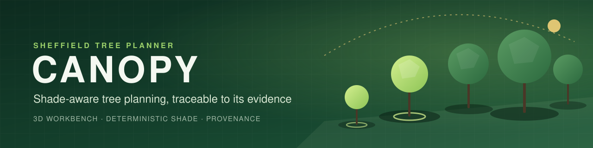
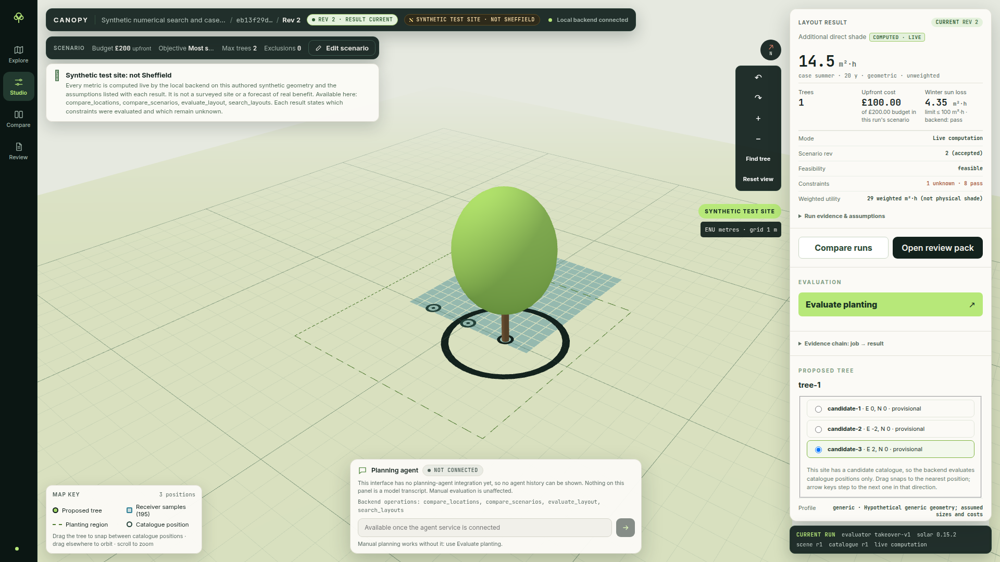
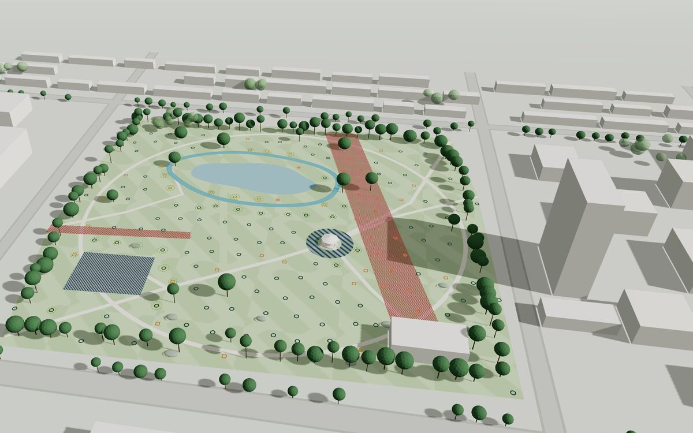
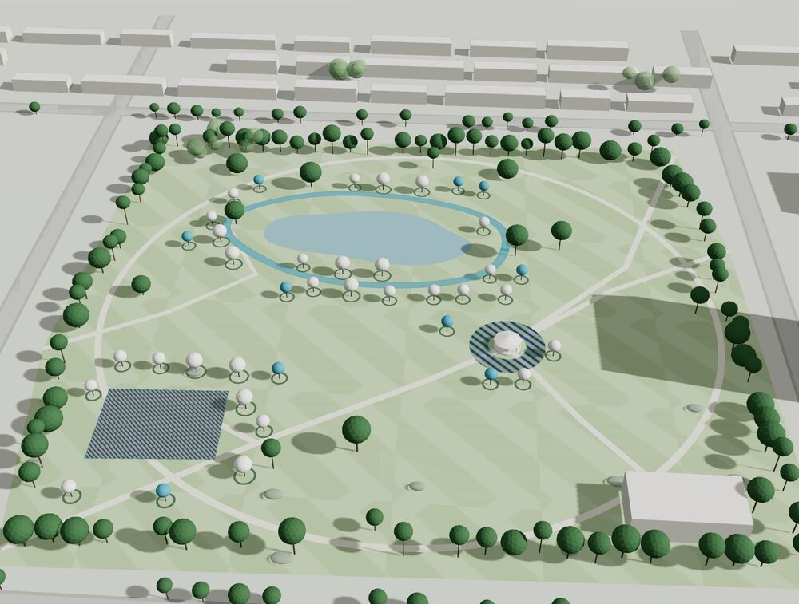
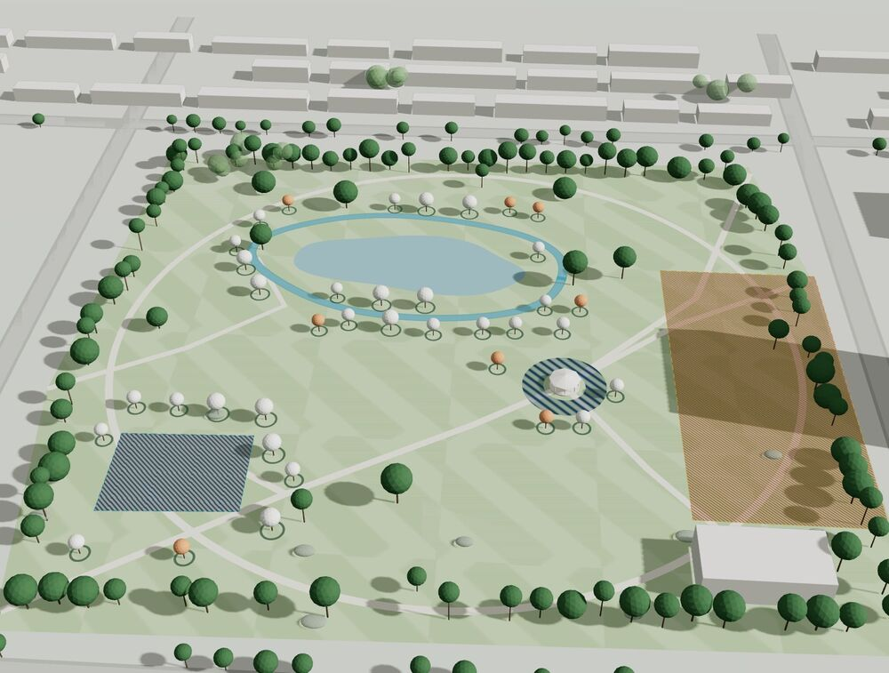
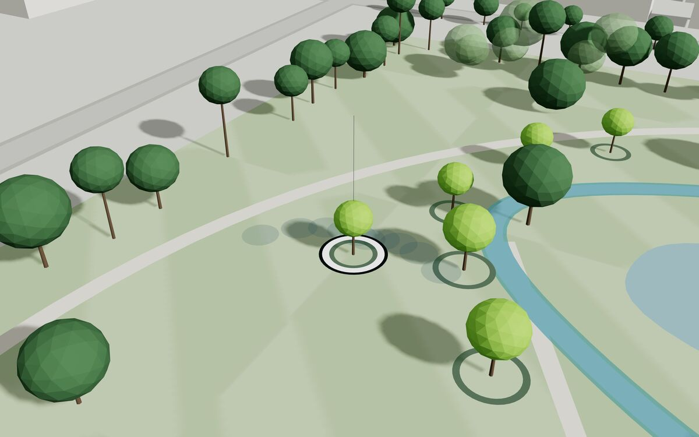
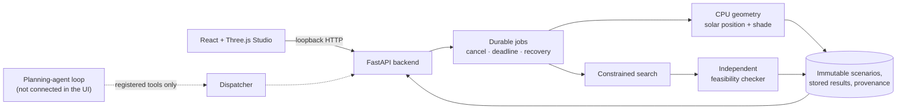

<div align="center">



<br>

**An editable 3D workbench for deciding where new trees should go, and showing why.**

[](https://github.com/Pimentellll/sheffield-tree-planner/actions/workflows/readiness.yml)
[](https://github.com/Pimentellll/sheffield-tree-planner/actions/workflows/frontend.yml)


[Overview](#overview) · [Features](#features) · [Gallery](#gallery) · [Architecture](#architecture) · [Quick start](#quick-start) · [Testing](#testing-and-packaging) · [Scope](#current-scope-and-limits) · [Docs](#documentation)

<sub>Built for <b>NVIDIA Hack for Impact · Sheffield 2026</b></sub>

</div>

---

> [!IMPORTANT]
> **The runnable demo uses an authored synthetic site.** It is not a surveyed Sheffield site and it is not a planting recommendation. The concept renders in the [gallery](#gallery) are illustrative design artwork, not computed results.

<p align="center">
  
  <br>
  <sub><i>Design concept, illustrative render: existing canopy (dark green), proposed planting (light green with rings) and excluded zones (red hatching). Synthetic scene, not surveyed geometry and not CANOPY output.</i></sub>
</p>

## Overview

A tree can look well placed on a map while shading the wrong area, duplicating shade that a building already casts or breaking the planting budget. Comparing alternatives fairly also means keeping the site, the time period and the assumptions the same for each one.

**CANOPY** brings those decisions into one editable 3D workbench. Deterministic numerical tools calculate the results, every result traces back to the inputs that produced it, and a changed input marks old results stale instead of quietly reusing them.

| | |
|---|---|
| **Who it is for** | Park and site managers, planners and local-authority teams deciding which tree-planting proposal deserves funding and a professional survey. This intended audience is a design hypothesis, not the result of user research. |
| **What it answers** | Where does this layout add shade, at what cost, under which constraints, and what changes if I edit it? |
| **What it will not do** | Guess. The UI reads stored results; it never estimates an answer itself, and unknown site conditions stay unknown. |

## Features

| | Capability | What it means in practice |
|---|---|---|
| 🌳 | **3D Studio** | Inspect the site and the proposed trees in a React and Three.js scene. |
| ✏️ | **Revision-safe editing** | Edit catalogue positions, the budget and supported requirements. Accept a revision and recompute it; the previous result is marked stale until the backend produces the new one. |
| ☀️ | **Deterministic shade** | Solar position and multi-tree and static shade are computed on the CPU by numerical tools, not by a model. |
| 🔎 | **Constrained search** | Search a finite planting catalogue for alternatives under the configured constraints. A separate checker then evaluates the supported constraints; survey-only items such as utilities stay unknown. |
| ⚖️ | **Run comparison** | Compare stored runs, shade metrics, costs and the supported winter-sun trade-offs side by side. |
| 🧾 | **Provenance and review packs** | Inspect assumptions, unknown constraints and provenance, then download a review pack built in the browser. |

> [!TIP]
> **Try this:** evaluate a layout, edit its budget, then accept the change. The old result is marked stale until the backend computes the new revision.

## Gallery

### The workbench today

<p align="center">
  
  <br>
  <sub><i>Actual synthetic-demo capture from <a href="https://github.com/Pimentellll/sheffield-tree-planner/actions/runs/43451276964">frontend CI</a>, commit <code>5b2dbd43</code>. The model is not connected in this run.</i></sub>
</p>

### Design direction

The renders below are downscaled copies of scene images embedded in the [Product Vision v2](docs/design/product-vision-v2/README.md) design file. They show the intended visual direction. They are stylised illustrations of a fictional park, not output from the CANOPY backend, and their producer and licence terms are not yet recorded.

<table>
  <tr>
    <td width="50%" align="center">
      <br>
      <sub><b>Accepted layout.</b> Proposed trees (light green, with planting rings) among the existing canopy.</sub>
    </td>
    <td width="50%" align="center">
      <br>
      <sub><b>Stale after an edit.</b> The previous layout stays visible as dashed ghosts for orientation only; no current result is shown.</sub>
    </td>
  </tr>
  <tr>
    <td width="50%" align="center">
      <br>
      <sub><b>Compare, layout A.</b> Trees only in this layout are blue; trees shared with layout B are white.</sub>
    </td>
    <td width="50%" align="center">
      <br>
      <sub><b>Compare, layout B.</b> One added exclusion zone (orange hatching); trees only in this layout are orange, shared trees are white.</sub>
    </td>
  </tr>
  <tr>
    <td colspan="2" align="center">
      <br>
      <sub><b>Selected tree.</b> One proposed tree, its planting ring and a drawn trail of shadow footprints (an illustrative overlay, not computed shade).</sub>
    </td>
  </tr>
</table>

<sub><i>All five renders: design concept, synthetic scene, not surveyed Sheffield geometry and not CANOPY output. The artboards they come from contain example figures and a placeholder park name that are not results; read the <a href="docs/design/product-vision-v2/README.md">design reference</a> before reusing anything from them.</i></sub>

## Architecture



- **The numerical tools own every calculation.** Every metric the interface shows comes from a stored backend result; percentages are browser arithmetic on those values. The agent's own wording is untrusted and can still be wrong.
- **Scenario revisions and result identities** keep stale, cached and superseded runs distinguishable.
- **Search proposes and a checker verifies.** A separate checker evaluates the supported constraints. Search results are evaluated alternatives, not claimed global optima.
- **The agent has no shell, arbitrary network or direct database access.** It can act only through the documented dispatcher and its registered tools.

### Repository layout

| Path | Contents |
|---|---|
| [`frontend/`](frontend/README.md) | Interface, scene renderer and browser checks (React 19, Three.js, Vite, TypeScript). |
| `backend/src/tree_planner/` | Contracts, local API, storage, jobs, physics, search, site import and the agent loop. |
| `backend/tests/`, `tests/` | Regression, protocol and integration checks. |
| `generated/` | JSON Schema, OpenAPI and TypeScript types generated from the backend contracts. |
| [`docs/`](docs/README.md) | Product scope, technical contracts, runbooks and engineering evidence. |

## Quick start

### Prerequisites

| Requirement | Version |
|---|---|
| Python | 3.11+ |
| Node.js | 22.12+ |
| [uv](https://docs.astral.sh/uv/) | current |

The manual demo needs neither model weights nor a cloud-model account.

### 1. Install

From the repository root:

```bash
uv sync --frozen --extra dev --python 3.11
npm ci --prefix frontend
```

### 2. Start the backend and the Studio

<details open>
<summary><b>Windows PowerShell</b></summary>

Terminal 1, repository root:

```powershell
.venv/Scripts/python.exe frontend/scripts/serve_physical.py --workspace ../canopy-physical-01 --winter
```

Terminal 2, repository root:

```powershell
$env:CANOPY_SESSION = (Resolve-Path ../canopy-physical-01/session.json).Path
npm --prefix frontend run dev -- --host 127.0.0.1
```

</details>

<details>
<summary><b>Linux</b></summary>

Terminal 1, repository root:

```bash
.venv/bin/python frontend/scripts/serve_physical.py --workspace ../canopy-physical-01 --winter
```

Terminal 2, repository root:

```bash
CANOPY_SESSION="$(realpath ../canopy-physical-01/session.json)" npm --prefix frontend run dev -- --host 127.0.0.1
```

</details>

### 3. Open the Studio

Go to **http://127.0.0.1:5173**. The backend listens on port **8765**.

> [!NOTE]
> Use a fresh workspace name for each new demo; existing workspaces are not overwritten. Stop both terminals with <kbd>Ctrl</kbd>+<kbd>C</kbd>. Keep the services on loopback: this is a single-user local workbench, not a public, multi-user or authenticated deployment.

## Testing and packaging

```bash
uv run --frozen --no-sync python -m pytest -q -rs
uv run --frozen --no-sync ruff check src backend scripts tests ci
uv run --frozen --no-sync python scripts/generate_api_types.py --check
npm --prefix frontend run build
npm --prefix frontend test
uv build
```

Some reference checks require the [pinned numerical source](docs/REFERENCE_RUNTIME.md), and live-model checks require explicit opt-in. A skipped model test is not proof that the model works. [Frontend setup](frontend/README.md) covers fresh-session browser checks; [physical runtime](docs/PHYSICAL_RUNTIME.md) covers the numerical demo and the non-interactive evidence path.

| Artefact | Contents |
|---|---|
| **Wheel** | The Python backend and the readiness CLI. |
| **Source distribution** | The above plus frontend source and its lockfile. The frontend still needs installation and a build. |

Neither artefact includes model weights or restricted site assets. [Backend CI](.github/workflows/readiness.yml) and [frontend CI](.github/workflows/frontend.yml) verify source and artefacts; they do not deploy them to the DGX.

## Current scope and limits

The working baseline is the **manual, local CPU planning workflow**.

| Area | Status |
|---|---|
| Manual planning workflow (edit, evaluate, search, compare, review pack) | ✅ Working baseline, local CPU |
| Site geometry | ⚠️ Authored flat-ground synthetic scene. Geospatial import and recorded-tree inventory tooling exist but do not prove a validated real-site workflow. |
| Planning agent | ⚠️ Local-model client, tool loop and evidence-presentation code exist, but the main interface does not yet provide a connected agent. |
| Nemotron tool use on the DGX Spark | ⏳ End-to-end use is not established. |
| Environmental claims | 🚫 Shade is not presented as measured cooling, carbon reduction, flood mitigation or energy-bill savings. |

See the [feature priorities](docs/FEATURE_PRIORITIES.md) for planned work and the [validation criteria](docs/VALIDATION.md) for what counts as evidence.

## Documentation

| Document | Read it for |
|---|---|
| [Documentation index](docs/README.md) | Where to start and what each document owns |
| [SPEC](docs/SPEC.md) | Product boundary, requirements and architecture |
| [CONTRACTS](docs/CONTRACTS.md) | Shared data meanings, operations, job states and errors |
| [NUMERICS](docs/NUMERICS.md) | Shading equations, optimisation and modelling limits |
| [VALIDATION](docs/VALIDATION.md) | Test specifications and acceptance matrix |
| [BUILD](docs/BUILD.md) | Work items, owners and current state (the only status home) |
| [DGX Spark](docs/DGX_SPARK.md) | Event deployment and local-inference readiness |
| [Product Vision v2](docs/design/product-vision-v2/README.md) | The newer visual direction and its caveats |

## Contributing

Read [AGENTS.md](AGENTS.md) before changing anything. In short:

- Open a pull request against `main`. A non-draft PR is squash-merged automatically once `readiness checks` passes, so CI is the review.
- Every PR keeps CI green and adds tests for what it changes. A shared contract change updates CONTRACTS or NUMERICS, the generated types and both producer and consumer tests in the same PR.
- Numerical truth comes from deterministic tools. Never present synthetic data as real Sheffield data or fabricate results.

## Team and licence

Built by **Ben**, **Arnav** and **Alex** for NVIDIA Hack for Impact Sheffield.

No open-source licence has been assigned, and public visibility alone does not grant reuse rights. Do not commit credentials, private prompts, restricted assets or generated runtime workspaces.

<div align="center">
<br>
<sub>CANOPY · <a href="https://github.com/Pimentellll/sheffield-tree-planner">Pimentellll/sheffield-tree-planner</a></sub>
</div>
