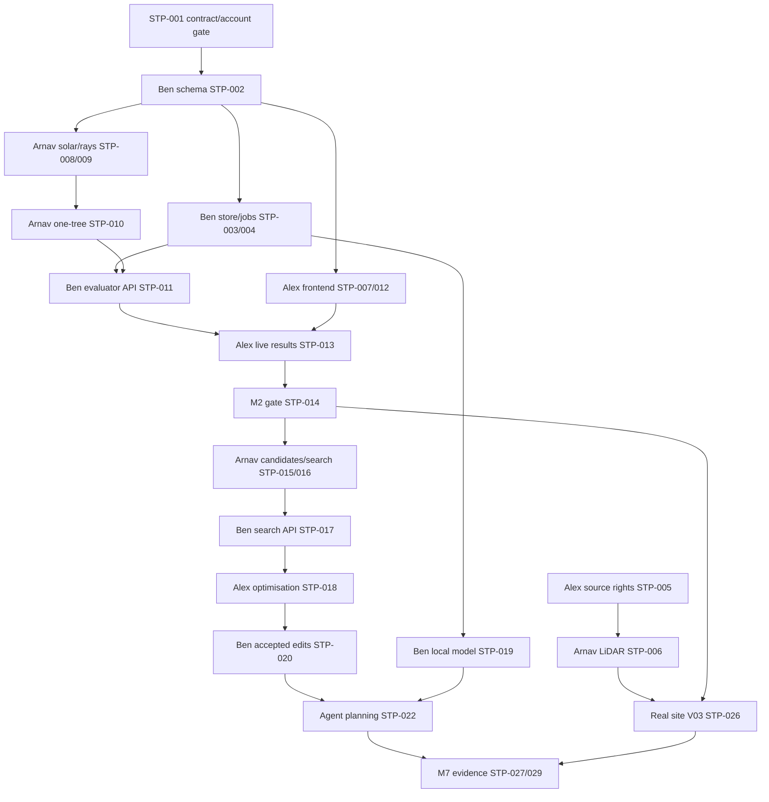

# Sheffield Tree Planner — three-agent execution PRD and issue specifications

**Status:** execution bootstrap, **not implemented work**, prepared 11 November 2026. **Scope:** P0/M0–M5 first, selected P1/M6, then evidence/M7. The canonical product and scientific meanings remain in [SPEC](SPEC.md), [CONTRACTS](CONTRACTS.md), [NUMERICS](NUMERICS.md), [VALIDATION](VALIDATION.md), [FEATURE_PRIORITIES](FEATURE_PRIORITIES.md), and [BUILD](BUILD.md). This document **does not replace** them or create a second task-status authority.

## 1. Product and outcome

Build a local-first, evidence-backed Sheffield urban-tree placement workbench. A user chooses an audited site, selects targets and constraints, evaluates geometric direct shade, searches feasible locations, changes a requirement, and sees a current run with cost, uncertainty and provenance. One genuine local open-model agent selects registered numerical tools and explains observed results. Site geometry and numerical claims, not polished graphics or text, determine correctness.

**P0 acceptance:** F001–F010 as defined in FEATURE_PRIORITIES, including a constrained viable proposal, correct stale-result behaviour, actual local model/tool round-trip and provenance. **First vertical slice M2 is smaller:** a labelled synthetic or rights-cleared site, one tree, actual evaluated shade difference, UI and stale/cancel/zero/failure states. A real Sheffield claim waits for V03/B08. P1 is scheduled only after supported P0 gates, and no needed hard winter constraint may be omitted simply because fuller season UI is P1.

## 2. Repositories, access, branches and PR policy

- Repository: **[bbeennyy860-cyber/sheffield-tree-planner](https://github.com/bbeennyy860-cyber/sheffield-tree-planner)**. Do not push to forks or another project as a workaround
- **Ben's canonical GitHub handle and repository owner:** `bbeennyy860-cyber`, confirmed by the team. The earlier `bbeennycyber` shorthand referred to Ben, not a separately verified repository account. Each agent must still verify the actual authenticated login and permissions before writing; STP-001 records that live access preflight
- **Ben:** backend, contracts, scenario/jobs, local agent and integration. Initial branch `agent/ben`
- **Arnav (`reverez`):** site geometry, solar/occlusion, optimisation and scientific verification. Initial branch `agent/arnav`
- **Alex (`akurkar07`):** source/right audit coordination, 3D UI, editing, results and demo. Initial branch `agent/alex`
- **Team integration branch:** `integration/sheffield-tree-planner`
- **Documentation bootstrap branch:** `docs/agent-execution-prd`, proposed to `main` by a **draft** PR
- Never commit to `main` directly. No automatic merge, rebase/force-push of others' branches, public deployment, submission, licence/visibility changes, spending or organiser contact
- The three `agent/*` branches are **first-task starting branches**, not permanent accumulating delivery branches. On first approved PR integration, retire that branch and create a new `feat/<owner>/<STP-ID>-<slug>` branch from the **latest integration HEAD** for each next issue. This preserves **one issue → one reviewable PR** and prevents stacked/unrelated commits
- Open **draft PRs** to `integration/sheffield-tree-planner`, not directly to `main`. Ben coordinates merges after owner/consumer review and the team's approval gate. PR #1, Spark readiness, is separate and must be inspected, not overwritten; PR #2 and #3 should be rechecked before assuming current state
- All three agents use **separate clones/worktrees**. A branch name alone does not isolate a shared working directory
- Issue titles use `[M#][B##][STP-###][Owner]` identifiers. GitHub milestone objects are optional coordination metadata; **M0–M7 in FEATURE_PRIORITIES remain authoritative** even if milestone objects cannot be created. GitHub issue comments are work-level conversation; **BUILD is still the only final task status/decision home**
- Ben exclusively edits shared `docs/BUILD.md` status and generated API types/lockfiles unless a specific single-writer handoff is recorded. Alex owns maintained `SOURCES.md` and site provenance source collection. Arnav owns scientific input semantics. Shared contract/spec changes require acknowledgement from every affected producer/consumer

## 3. Run each agent against the correct branch

All three sessions first fetch remote updates, inspect the current branch/commit, current open PRs, the issue queue and this document, and assert that they have **their own** verified GitHub login. Do not silently change another agent's clone or working tree.

| Agent | Starting branch | Initial work | Handoff |
| --- | --- | --- | --- |
| Ben | `agent/ben` | STP-001 coordination, then STP-002 contracts; inspect existing Spark readiness PR #1 | Publish tested schemas and versioned API types for Arnav/Alex |
| Arnav | `agent/arnav` | STP-006 geometry on isolated synthetic data or STP-008 solar reference; assist STP-005 rights audit | Publish geometry frame, tests and solver/evaluator handoff |
| Alex | `agent/alex` | STP-005 site sources/rights and STP-007 frontend skeleton; keep disjoint files/issues | Publish UI shell with labelled synthetic fixture and viewer requirements |

**Session-start instruction:** check the issue matching your first task and comment `START:` with branch + base commit + owned paths + dependency status before editing. **Do not claim that STP-001 acknowledgement has already happened.** Isolated sketches may proceed under a named draft contract, but integrated use of disputed meanings waits for the three human acknowledgements.

A paid coding subscription does not itself supply always-on background execution, a live GitHub watcher, local shell, real model endpoint or Spark runtime. Sessions must actually be running with permitted credentials and review their issue/PR messages when active.

## 4. GitHub coordination protocol

1. Find the `STP-###` issue; if absent, create **one**, after checking for duplicates. It has exactly one human owner and one active agent writer. Inspect dependencies and branch tip before beginning
2. `START: STP-ID | owner | branch | base SHA | intended paths | dependency evidence`
3. `STATUS: code SHA | actual checks | discovered limitation | next dependency` for meaningful checkpoints, roughly every 20–30 minutes when work is active
4. `REQUEST: @owner | exact interface/data question or change | impacted producers/consumers | suggested test`
5. `BLOCKED: prerequisite | what can still proceed safely | who must answer`
6. `READY: draft PR URL | tests run and unrun | acceptance IDs | changed files | required reviewer`
7. `REVIEW: finding and severity | reproduction | required change`
8. `INTEGRATED: merge SHA | verified acceptance | consumer actions` only after an approved integration
9. Do not close an issue or update BUILD to Verified merely because a coding agent states success. Ben records **actual integrated revision** and independent evidence once accepted
10. Do not repeatedly poll inactive sessions or assume autonomous monitoring. Use real GitHub issue/PR comments as durable handoffs, not hidden assistant context

**Change protocol:** a changed unit/field/tool meaning requires an issue `REQUEST:`, explanation of migrations and tests, and Arnav/Ben/Alex acknowledgement as consumers require. Never create separate wire types in each codebase. Backend generated OpenAPI/TS types are authoritative after B01.

**Independent review rule:** Ben reviews Arnav's numerical integration and Alex's client/API uses; Arnav verifies scientific claims in Ben's tool/agent PRs and Alex's displayed metrics; Alex reviews usability and critical state presentation. No agent signs off its own consequential calculations or merges itself without the agreed approval.

**Evidence required for every PR:** STP/M/B/F/V IDs; base and head SHAs; changed files; actual commands/output; expected vs actual numeric cases where applicable; UI screenshots where rendered; provenance/licence information for real data; tests not run; failure paths; review handoff; effect on shared contracts. PRs start as drafts with no reviewers requested until the agreed review/publication gate.

## 5. Ownership and scope boundaries

| Path/module (planned, inspect actual tree first) | Writer | Contract/reviewer |
| --- | --- | --- |
| `backend/src/tree_planner/contracts/`, `api/`, `jobs/`, `agent/`; migrations, main API type generator | Ben | Arnav for geometry/numerics, Alex for UI consumption |
| `backend/src/tree_planner/physics/`, `search/`, scientific site transform/preprocessing | Arnav | Ben for typed API; Alex for viewer parity |
| `frontend/`, visual scenes, panels, UI integration tests | Alex | Ben for job/revision correctness; Arnav for geometry and metrics |
| Source bibliography, site rights research and source registry | Alex | Arnav for semantics, Ben for permissions |
| `docs/BUILD.md`, shared deps/lockfiles, integration scripts, final export service | Ben by default | Both consumers as needed |

File paths in the proposed layout are **not** proof those files exist. Do not create a second app architecture. Work on minimum compatible scaffolds first, coordinated at PR boundaries. Ask before editing another lane's files.

## 6. Dependency map and exit gates



**M0:** contract acknowledgement, current repository/account verification, portable schema and source/rights audit. **M1:** independent solar/ray references and baseline-one-tree. **M2:** real backend-to-UI shade result with stale, zero and failure semantics. **M3:** independently validated feasible search and comparisons. **M4:** one genuine local model-selected tool call, can run alongside M1–M3 once an operation is implemented. **M5:** human accepted constraint edit triggers correct recomputation and agent action. **M6:** selected P1 crown states, controlled comparison, UI evidence. **M7:** real Sheffield evidence if rights allow, reproducible demonstration and honest reported limits. **M7 scoped P0 release is not automatically full B11/B12 verification.**

**Release blockers:** invalid known hard constraint, fabricated/mislabelled metric, stale-result resurrection, unverified local-agent claim, unsafe source export, or unclear event eligibility for submitted assets. GPU acceleration, full city, AQI/CO2/flood/irrigation benefit models, public hosting and P2/P3 are **not** critical-path tasks. Planting permission and unknown underground assets remain professional survey requirements.

## 7. Issue specifications

Each issue below is a **single reviewable deliverable**. Its acceptance points are minimum observable evidence, not a relaxation of the referenced full V test. When creating GitHub Issues, copy its corresponding section and use the bracketed title. Dependencies are stable `STP-###` identifiers; GitHub numeric issue IDs are not a source of truth.

### STP-001 | [M0][B01][STP-001][Ben] Confirm contracts, accounts, branch/PR governance

**Owner:** Ben · **Priority:** P0 gate · **Features:** F007,F008,F009 · **Reviewers:** Alex and Arnav

**Dependencies:** None

**Inputs:** Current AGENTS, CONTRACTS, BUILD, event rules and GitHub access

**Output:** Three human acknowledgements, exact contract revision and agreed integration policy

**Owned paths:** Coordination issue and Ben-owned BUILD entries

**Acceptance:**
- Get Alex/Arnav/Ben acknowledgement on exact CONTRACTS/NUMERICS revision
- Verify Ben's active GitHub session is authenticated as `bbeennyy860-cyber` and has appropriate repository access; his identity is team-confirmed, but session credentials and permissions must still be checked
- confirm event rules or mark unknown
- confirm no automatic merges, one shared-file writer

**Tests and evidence:** Record links to acknowledgement and unresolved gates; no coding task falsely marked implemented

**Consumers:** All agents and all dependent task owners

### STP-002 | [M0][B01][STP-002][Ben] Implement typed domain schemas and API type generation

**Owner:** Ben · **Priority:** P0 · **Features:** F001,F003,F004,F007 · **Reviewers:** Arnav, Alex

**Dependencies:** STP-001 contract acknowledgement for shared semantics

**Inputs:** CONTRACTS §§1–4, V01 and chosen compatible versions

**Output:** Pydantic schemas, OpenAPI and generated frontend types

**Owned paths:** backend/src/tree_planner/contracts/, generated types, their tests

**Acceptance:**
- Validate SiteBundle, tree profile/state, placement, layout, scenario, units and revisions
- reject unknown fields, nonfinite numbers, bad CRS/north and malformed references
- keep backend schemas as single serialization authority

**Tests and evidence:** Real schema tests including valid synthetic input and malformed values; generated API/TS type consistency smoke

**Consumers:** Arnav importer/physics and Alex typed UI

### STP-003 | [M0][B01][STP-003][Ben] Persist immutable scenarios, sources, fingerprints and asset rights

**Owner:** Ben · **Priority:** P0 · **Features:** F009,F010 · **Reviewers:** Alex, Arnav

**Dependencies:** STP-002

**Inputs:** CONTRACTS §§2,4,9, V01/V05

**Output:** SQLite scenario revisions, content hashes, approved asset registry and rights checks

**Owned paths:** backend/src/tree_planner/{site,jobs,contracts}/ and tests, no scientific implementation

**Acceptance:**
- Create/retrieve immutable revisions with If-Match conflict
- deterministic content/fingerprint rules
- reject traversal, arbitrary URLs, bad rights and stale references
- distinguish accepted/hypothetical scope

**Tests and evidence:** Round-trip persistence, same-key reproducibility, conflict/forbidden-asset tests and restart smoke

**Consumers:** Alex's scenario editor, Arnav's site importer

### STP-004 | [M0][B01][STP-004][Ben] Implement job worker, selection identity and evaluation API shell

**Owner:** Ben · **Priority:** P0 · **Features:** F009,F010 · **Reviewers:** Alex, Arnav

**Dependencies:** STP-002, STP-003

**Inputs:** CONTRACTS §§5,8–9, V05

**Output:** Bounded worker, submit/poll/cancel endpoints, typed errors and result delivery envelope

**Owned paths:** backend/src/tree_planner/{api,jobs}/ and tests

**Acceptance:**
- queued/running/completed/failed/cancelled lifecycle
- backend latest-selection sequence even for same revision
- idempotency and cache delivery preserve original result
- restart interruption and deadline failures never look successful

**Tests and evidence:** Out-of-order completion, cancellation races, idempotent retry, duplicate-ID conflict and error-schema tests

**Consumers:** Arnav evaluation, Alex UI and Ben agent adapter

### STP-005 | [M0][B03][STP-005][Alex] Audit candidate Sheffield site data, provenance and display rights

**Owner:** Alex · **Priority:** P0 · **Features:** F001 · **Reviewers:** Arnav, Ben

**Dependencies:** STP-001 for shared site meaning; independent source research can begin

**Inputs:** SOURCES, SiteBundle rights fields, V03; chosen park + fallback

**Output:** Source-by-source manifest, dates/terms, site proposal, missing-data and licence decision

**Owned paths:** docs/site-audit/ or agreed private site manifest location, no raw restricted assets

**Acceptance:**
- Inspect DTM/DSM capture dates/coverage, parks/trees/buildings/OS rights, allowable local/share/display/export flags
- distinguish unknown survey conditions from absence
- propose a bounded site and fallback

**Tests and evidence:** Source URL/licence evidence, candidate bounding extents, missing context/rights cases, Arnav review

**Consumers:** Arnav's import and Ben's rights-checked asset registry

### STP-006 | [M0][B03][STP-006][Arnav] Prototype site-size terrain and obstruction import

**Owner:** Arnav · **Priority:** P0 · **Features:** F001 · **Reviewers:** Alex, Ben

**Dependencies:** STP-002 geometry contract; STP-005 for real data rights, synthetic pilot allowed earlier

**Inputs:** DTM/DSM or synthetic test rasters; transforms and height datum conventions

**Output:** Reproducible clipped mesh/terrain data and site transform evidence

**Owned paths:** backend/src/tree_planner/site/, preprocessing scripts/tests, rights-cleared manifests

**Acceptance:**
- Preserve EPSG:27700 and known height datum through ENU transform
- classify or flag buildings/vegetation
- no DSM canopy double-count
- provide shared geometry/viewer transform and context boundary warnings

**Tests and evidence:** Known point/north/metre roundtrip, no-data/reprojection tests and measured mesh-size report; no unverified Sheffield claim

**Consumers:** Alex viewer, Arnav ray engine and Ben SiteBundle

### STP-007 | [M0][B05][STP-007][Alex] Create typed frontend scaffold and labelled synthetic scene

**Owner:** Alex · **Priority:** P0 · **Features:** F002 · **Reviewers:** Ben, Arnav

**Dependencies:** STP-001 for agreed frame; may scaffold with provisional adapter before STP-002

**Inputs:** SPEC section 5, CONTRACTS frame, V10

**Output:** React/TS app startup, scene shell, accessible layout, synthetic fixture labelled

**Owned paths:** frontend/ and frontend tests; coordinate dependencies with Ben

**Acceptance:**
- Working local frontend build
- camera orbit/pan/zoom and readable site status
- no fake numerical results
- explicit missing-backend/data/error states

**Tests and evidence:** Actual build/test output and screenshot at desktop and narrow sizes; documented viewer coordinate assumptions

**Consumers:** Ben API and Arnav site geometry

### STP-008 | [M1][B02][STP-008][Arnav] Implement solar position and UTC time-bin reference

**Owner:** Arnav · **Priority:** P0 · **Features:** F003 · **Reviewers:** Ben, Alex

**Dependencies:** STP-002; independent maths tests may start against named draft

**Inputs:** NUMERICS §§4.1, VALIDATION V02, pvlib

**Output:** Validated solar direction and time-bin utilities

**Owned paths:** backend/src/tree_planner/physics/solar*, physics tests

**Acceptance:**
- Correct ENU north/azimuth/elevation
- handle DST, night, bins and target normals
- deterministic finite outputs and independent solar reference comparison

**Tests and evidence:** Reference instants and pole shadow directions, daylight saving ambiguity/non-overlap unit tests

**Consumers:** STP-009 solver and Alex time controls

### STP-009 | [M1][B02][STP-009][Arnav] Implement ray intersections and static occluder reference

**Owner:** Arnav · **Priority:** P0 · **Features:** F003 · **Reviewers:** Alex, Ben

**Dependencies:** STP-002, STP-008; synthetic mesh need not wait for STP-006

**Inputs:** NUMERICS §§4.2–4.3, VALIDATION V02

**Output:** Testable analytic ellipsoid/trunk and static-mesh occlusion queries

**Owned paths:** backend/src/tree_planner/physics/geometry*, physics tests

**Acceptance:**
- Ellipsoid hit/miss/tangent/inside
- trunk and static scene occlusion
- ray offsets, surface normals and consistent ENU geometry
- no reliance on decorative renderer shadows

**Tests and evidence:** Closed-form intersections, wall/pole cases, grazing/signed-direction tests and CPU reproducibility

**Consumers:** STP-010 one-tree evaluator and Alex shading view

### STP-010 | [M1][B04][STP-010][Arnav] Compute baseline versus exactly one tree shade gain

**Owner:** Arnav · **Priority:** P0 · **Features:** F003,F004 · **Reviewers:** Ben, Alex

**Dependencies:** STP-008, STP-009, STP-002

**Inputs:** NUMERICS shade integration, VALIDATION V02/V04

**Output:** Deterministic evaluator returning m²·h and provenance for baseline/proposal

**Owned paths:** backend/src/tree_planner/physics/evaluator*, physics tests

**Acceptance:**
- Use identical surface/time samples
- evaluate existing static shade before proposal
- count net additional shade once
- return correct zero benefit and labelled cost/unit/horizon when available

**Tests and evidence:** Test empty scene, already-shaded target, non-overlapping and overlapping simple reference scenarios, finite outcomes

**Consumers:** Ben STP-011 endpoint, Alex STP-012/013

### STP-011 | [M1][B04][STP-011][Ben] Connect real evaluator to asynchronous result API

**Owner:** Ben · **Priority:** P0 · **Features:** F004,F010 · **Reviewers:** Alex, Arnav

**Dependencies:** STP-004, STP-010

**Inputs:** CONTRACTS result/job identity, V04/V05

**Output:** HTTP→job→numeric run→immutable result, with real execution fixtures

**Owned paths:** backend/src/tree_planner/{api,jobs}/ and integration tests

**Acceptance:**
- Process real one-tree request and preserve input hashes, versions and metric-instance IDs
- expose exact job/current selection
- no handwritten happy-path computation fixtures

**Tests and evidence:** End-to-end real evaluator smoke, invalid input, cancelled and stale job results

**Consumers:** Alex STP-013, STP-014; Ben tool adapter

### STP-012 | [M2][B05][STP-012][Alex] Render selectable 3D site, proposed tree and target editor

**Owner:** Alex · **Priority:** P0 · **Features:** F002 · **Reviewers:** Arnav, Ben

**Dependencies:** STP-007, STP-002; STP-006 for real-site parity, synthetic okay

**Inputs:** SiteBundle frame, TreeProfile/Placement, V10

**Output:** Interactive scene with target selection and one proposed tree

**Owned paths:** frontend/src/scene/, related components/tests

**Acceptance:**
- Correct scale/orientation, existing vs proposed and exclusions
- place/move with keyboard fallback and derived trunk height
- avoid implying that view-only sun time changes analyses

**Tests and evidence:** Known ENU point, north and crown-size comparison with Arnav; interactive screenshot and input tests

**Consumers:** Alex STP-013 and STP-017; Arnav real site

### STP-013 | [M2][B05][STP-013][Alex] Implement evaluation controls, job status and stale result guard

**Owner:** Alex · **Priority:** P0 · **Features:** F009,F010 · **Reviewers:** Ben, Arnav

**Dependencies:** STP-007, STP-011, STP-012

**Inputs:** CONTRACTS jobs/result/delivery and V05/V10

**Output:** Scenario form, real API polling/cancel and evidence/results panel

**Owned paths:** frontend/src/{api,panels}/ and tests

**Acceptance:**
- Show actual m²·h, unit, cost assumptions, provenance
- immediately mark unsaved edits stale
- handle same-revision newer selection, zero/provisional/failure/cancelled/cached/fixture states correctly

**Tests and evidence:** Frontend automated state transitions plus genuine integrated API response; desktop/narrow screenshot inspection

**Consumers:** STP-014 integrated M2, later optimiser and agent UI

### STP-014 | [M2][B01/B04/B05][STP-014][Ben] Prove M2 complete vertical slice with independent review

**Owner:** Ben · **Priority:** P0 gate · **Features:** F002,F003,F004,F009,F010 · **Reviewers:** Alex, Arnav

**Dependencies:** STP-011, STP-012, STP-013

**Inputs:** M2 gate, V01/V02/V04/V05/V10

**Output:** One reproducible synthetic scene → API → evaluator → UI and evidence trail

**Owned paths:** integration tests, runbook updates, BUILD evidence (Ben writer)

**Acceptance:**
- Create one real backend computation visible on UI
- prove revised scenario does not display old completion
- test valid zero gain and failures
- disclose synthetic provenance

**Tests and evidence:** Clean local commands, actual run ID/metric, UI screenshot and Arnav/Alex review; do not call M2 full P0

**Consumers:** All downstream branches; Ben agent

### STP-015 | [M3][B06][STP-015][Arnav] Generate candidate catalogue and independently validate hard constraints

**Owner:** Arnav · **Priority:** P0 · **Features:** F005,F007 · **Reviewers:** Ben, Alex

**Dependencies:** STP-002, STP-006 or labelled synthetic site, STP-010

**Inputs:** CONTRACTS candidate/scenario constraints, V04/V06

**Output:** Finite candidate/profile library and independent layout feasibility checker

**Owned paths:** backend/src/tree_planner/{site,search}/ and tests

**Acceptance:**
- Version catalogue/fingerprint
- budget in integer pence, region/exclusions, spacing, pins, location uniqueness, count, applicable winter limits
- unknown utilities/permission remain survey warnings

**Tests and evidence:** Include deliberately invalid candidates/layouts and final-validator rejection; price scope/unit checks

**Consumers:** STP-016 optimisation and Ben STP-017 API

### STP-016 | [M3][B06][STP-016][Arnav] Implement deterministic reference search and marginal-gain optimisation

**Owner:** Arnav · **Priority:** P0 · **Features:** F006 · **Reviewers:** Ben, Alex

**Dependencies:** STP-010, STP-015

**Inputs:** NUMERICS search policy, V06

**Output:** Reference baseline and best evaluated feasible layout with trace/seed

**Owned paths:** backend/src/tree_planner/search/ and tests

**Acceptance:**
- Greedy marginal gain with feasible local improvement
- overlap-aware masks
- report count, spend, shade, no eligible/zero/target miss
- never call heuristic outcome globally optimal

**Tests and evidence:** Exhaustive tiny-case comparison and deterministic repeat tests including disjoint and overlapping tree shadows

**Consumers:** Ben search API, Alex search UI

### STP-017 | [M3][B06][STP-017][Ben] Expose search as a job with validated, provenance-rich results

**Owner:** Ben · **Priority:** P0 · **Features:** F005,F006,F010 · **Reviewers:** Alex, Arnav

**Dependencies:** STP-004, STP-015, STP-016

**Inputs:** CONTRACTS operations, results, V04/V05/V06

**Output:** search_layouts handler, job endpoint and result identities

**Owned paths:** backend/src/tree_planner/{api,jobs}/ and integration tests

**Acceptance:**
- Respect immutable scenario/catalogue identities, cost/count, independent feasibility
- distinguish selection per evaluation/search slot
- report target miss and failed deadline appropriately

**Tests and evidence:** Actual HTTP search smoke, invalid scenario, stale/retry/unknown output tests

**Consumers:** Alex optimisation panels, local agent

### STP-018 | [M3][B05][STP-018][Alex] Display reference and optimised planting alternatives

**Owner:** Alex · **Priority:** P0 · **Features:** F002,F010 · **Reviewers:** Arnav, Ben

**Dependencies:** STP-013, STP-017

**Inputs:** CONTRACTS comparison/result and V10

**Output:** Map alternatives, cost/shade comparison and constraint explanations

**Owned paths:** frontend/src/{scene,panels}/ and tests

**Acceptance:**
- Actual evaluated layouts and IDs, not fake bars
- show objective, candidate status, actual budget/spend/count
- explain infeasible or unmet target without claiming proof

**Tests and evidence:** UI test against real search result and screen capture; feedback from Arnav on physical meaning

**Consumers:** STP-022 agent replanning, demo

### STP-019 | [M4][B09][STP-019][Ben] Integrate local inference adapter and prove one genuine tool round-trip

**Owner:** Ben · **Priority:** P0 · **Features:** F008 · **Reviewers:** Arnav, Alex

**Dependencies:** STP-002, STP-004; inspect existing PR #1 and avoid duplicating it

**Inputs:** B09, V08; exact local runtime and registered tool schema

**Output:** Recorded real model-selected tool → dispatcher → observation → grounded response

**Owned paths:** backend/src/tree_planner/agent/, runtime config/tests; coordinate PR #1

**Acceptance:**
- Verify local model/checkpoint/parser
- connect to implemented inspect/evaluate endpoint
- reject malformed tool args
- record device, versions, timings and actual logs
- synthetic HTTP readiness fixtures are insufficient

**Tests and evidence:** Actual inference trace with model-selected arguments and execution evidence, plus unavailable-runtime fallback test

**Consumers:** STP-023 agent loop, Alex tool UI

### STP-020 | [M5][B01/B10][STP-020][Ben] Enforce accepted revisions and recomputation on changed constraints

**Owner:** Ben · **Priority:** P0 · **Features:** F009 · **Reviewers:** Alex, Arnav

**Dependencies:** STP-003, STP-004, STP-017, STP-014

**Inputs:** CONTRACTS human acceptance and selection semantics, V05/V09

**Output:** Backend route/operation for accepted budget/exclusion change and new job

**Owned paths:** backend/src/tree_planner/{contracts,api,jobs}/ and tests

**Acceptance:**
- Hypothetical never self-activates
- human-approved revision creates new identity
- old jobs cannot become current
- preserve unchanged hard constraints and exact actual result

**Tests and evidence:** Out-of-order run and invalid approval-flag tests; full run cache rejects changed budget outcome

**Consumers:** Alex replanning UI, Ben agent

### STP-021 | [M5][B05][STP-021][Alex] Make accepted edits and recomputed proposals visible and safe

**Owner:** Alex · **Priority:** P0 · **Features:** F009 · **Reviewers:** Ben, Arnav

**Dependencies:** STP-013, STP-018, STP-020

**Inputs:** CONTRACTS revision and progress rules, V05/V10

**Output:** Editable budget/exclusion UI, accept/reject flows, stale/recompute states

**Owned paths:** frontend/src/{api,panels,scene}/ and tests

**Acceptance:**
- Show unsaved draft separate from accepted revision, require human acceptance, initiate real recomputation, never restore stale result after latest request fails

**Tests and evidence:** Simulate race and rejected edit; real integration trace and screenshot

**Consumers:** Ben agent replanning and demo

### STP-022 | [M5][B10][STP-022][Ben] Implement evidence-driven agent planning loop with bounded domain tools

**Owner:** Ben · **Priority:** P0 / selected P1 · **Features:** F008,F009 · **Reviewers:** Arnav, Alex

**Dependencies:** STP-019, STP-017, STP-020

**Inputs:** CONTRACTS registered operations, SPEC agent rules, V09

**Output:** One local agent dispatch loop with inspect/search/evaluate/recompute and grounded explanations

**Owned paths:** backend/src/tree_planner/agent/ and tests

**Acceptance:**
- Select correct registered action from user request
- observe actual results
- cite run/metric identities
- refuse unsupported impact claims
- protect accepted/hypothetical permissions and stop on no progress

**Tests and evidence:** Model/tool traces including ordinary, unsupported, invalid/stale and tool-failure cases

**Consumers:** Alex agent UI, independent benchmark

### STP-023 | [M6][B07][STP-023][Arnav] Add crown growth/leaf-state cases, winter limits and sensitivity

**Owner:** Arnav · **Priority:** P1 after P0 · **Features:** F011,F012,F014 · **Reviewers:** Ben, Alex

**Dependencies:** STP-010, STP-015

**Inputs:** NUMERICS and CONTRACTS profile states, V02/V07

**Output:** Versioned scenario evaluator with fixed-crossing transmission and separate cases

**Owned paths:** backend/src/tree_planner/{physics,search}/ and tests

**Acceptance:**
- Keep establishment/mature and summer/winter separate
- enforce selected hard winter limits
- calculate fixed-crossing blocking correctly
- invalidate incompatible geometry/time masks

**Tests and evidence:** Transmission 0.8×0.5×0.25 example, winter checks, geometry/time/context refinement and cache-compatibility tests

**Consumers:** Ben agent, Alex comparisons

### STP-024 | [M6][B07][STP-024][Arnav] Implement controlled location and scenario comparisons

**Owner:** Arnav · **Priority:** P1 · **Features:** F013,F015 · **Reviewers:** Ben, Alex

**Dependencies:** STP-016, STP-023

**Inputs:** CONTRACTS compare_locations/compare_scenarios, V07

**Output:** Validated counterfactual results and changed-input reports

**Owned paths:** backend/src/tree_planner/{physics,search}/ and tests

**Acceptance:**
- Relocation holds other trees/assumptions fixed
- distinguish redesign
- report infeasible alternative diagnostics
- comparison deltas identify exact metric instances and changed inputs

**Tests and evidence:** Relocation invariant and infeasible diagnostic tests; no unsupported cost optimum claim

**Consumers:** Ben domain dispatcher, Alex comparison UI

### STP-025 | [M6][B05][STP-025][Alex] Build season, controlled-comparison and agent evidence panels

**Owner:** Alex · **Priority:** P1 · **Features:** F011,F012,F013,F014,F018 · **Reviewers:** Arnav, Ben

**Dependencies:** STP-021, STP-022; STP-023/024 for corresponding panels

**Inputs:** V07/V09/V10, real Result and Job records

**Output:** Season selector, comparison charts, agent tool history and evidence view

**Owned paths:** frontend/src/{scene,panels}/ and tests

**Acceptance:**
- Clearly distinguish view-only timeline from analysis
- show original/alternative layout and winter tradeoff
- no invented temperature/AQI/CO2/flood savings
- reveal failure/uncertainty

**Tests and evidence:** Real comparison trace and visual/keyboard tests with screenshots

**Consumers:** Final demo

### STP-026 | [M7][B08][STP-026][Arnav] Prove real Sheffield site geometry and numerical parity

**Owner:** Arnav · **Priority:** P0 real-site gate · **Features:** F001,F010 · **Reviewers:** Alex, Ben

**Dependencies:** STP-005, STP-006, STP-014, STP-015

**Inputs:** V03 plus B08 real-site integration proof

**Output:** Rights-cleared real-site SiteBundle and validation record or explicit rejected site

**Owned paths:** backend/src/tree_planner/site/, approved manifests, integration tests

**Acceptance:**
- Prove lawful use/display/export
- known point/north/height context
- static scene semantics and existing canopy
- identical solver/UI transform with Alex
- state unknown survey conditions

**Tests and evidence:** Actual Sheffield site test run and geometry checks, licence evidence, UI parity review; no fabricated assets

**Consumers:** Final proof, demo

### STP-027 | [M7][B11][STP-027][Arnav] Independently evaluate AI value against manual and fixed workflows

**Owner:** Arnav · **Priority:** Full-core gate; P0 demo may be scoped · **Features:** F008,F013 · **Reviewers:** Alex, Ben

**Dependencies:** STP-022; demonstrated P0 workflow and agreed held-out tasks

**Inputs:** V09/V11, baseline task suite

**Output:** Same-input comparison of manual, fixed and adaptive-agent tasks with failures

**Owned paths:** tests/benchmarks/ or agreed evidence-only path, no secret data

**Acceptance:**
- Measure completion, constraint accuracy, unsupported claims, interventions, relevant investigations and total time
- independent scorer not Ben
- preserve raw observed failures

**Tests and evidence:** Repeated held-out runs and complete config/revision/timing record; truthful negative findings

**Consumers:** Ben release claim and Alex presentation

### STP-028 | [M7][B12][STP-028][Alex] Package reviewable proposal export UI and final visual demo

**Owner:** Alex · **Priority:** P1/P0 demo · **Features:** F010,F018 · **Reviewers:** Ben, Arnav

**Dependencies:** STP-014, STP-018, STP-021; STP-025 if implemented

**Inputs:** V10/V12, approved export handler

**Output:** Rights-aware map/results interface, accessible demo and screenshot evidence

**Owned paths:** frontend/src/{api,panels,scene}/ and tests

**Acceptance:**
- Use only returned validated and permitted export fields
- label geographic versus ENU positions
- link metric to provenance and human survey requirements
- no demo-only fake calculations

**Tests and evidence:** End-to-end export response, real UI capture at 1920×1080 and narrow screen, failure recovery UX test

**Consumers:** Ben full-system rehearsal

### STP-029 | [M7][B12][STP-029][Ben] Verify clean build, demo recovery, claim ledger and integration release gate

**Owner:** Ben · **Priority:** P0 demo gate · **Features:** F008,F009,F010 · **Reviewers:** Alex, Arnav

**Dependencies:** STP-014, STP-019, STP-022, STP-026; remaining work as scope permits

**Inputs:** B12/V12, eligibility and model/site gates

**Output:** Reproducible install/start/smoke, tested fallbacks and explicit claim ledger

**Owned paths:** integration scripts, tests, docs/BUILD.md as single writer

**Acceptance:**
- Another teammate installs from clean checkout
- prove real compute, real model or explicitly mark incomplete
- no silent stale, unsafe export or unsupported claims
- preserve known-good restore and no auto submission

**Tests and evidence:** Commands/output, source+data+model hashes, runtime screenshots and measured timings; separate M7 scoped candidate from full B11/B12 verified

**Consumers:** All teammates and hackathon reviewers

## 8. Implementation decisions that cannot be invented by agents

- Authoritative contract acknowledgement, first site/fallback acceptance, source rights, organiser rules and new environmental modules require the relevant human decision. Record an unknown, not a guessed yes
- The source coordinate frame is local east/north/up **metres**, source CRS/datum explicit; never confuse map coordinates with latitude/longitude or current UTC with local daylight saving
- Main numeric output is additional direct geometric shade in **m²·h**, not ambient cooling, electricity savings, AQI or annual CO2 offset. Weighted benefit is separately labelled. Budget basis is upfront integer GBP pence
- Initial crown is opaque ellipsoid plus trunk; partial crossing transmission is a tested B07 enhancement. Existing canopy included in geometry must never be counted again as independent crown
- Solver numerical truth is not replaced by Three.js visual shadows, AI narrative or untested static fixtures. Synthetic data must be conspicuously labelled
- Only registered runtime domain tools execute work. The planning agent has no arbitrary network, shell, host files, direct SQL or self-authorisation. Hypotheticals do not become accepted scenarios without a real human acceptance path
- If a branch/PR changes accepted B01 contract meanings, pause affected integration and request approval with tests. A speculative research dossier recommendation is not authority to rewrite CONTRACTS
- No hidden background-run promise. Inactive agents cannot exchange information until restarted/reconnected. A human integrator still controls scope, approvals, final review and submission

## 9. Completion checklist and first-session commands

Start sessions only in authorised working clones with credentials set privately, and inspect remote state before writing. Suggested command sequence (illustrative, not yet runtime-tested):

```bash
git fetch origin
git switch --track origin/agent/alex  # Alex only
# Arnav uses origin/agent/arnav and Ben uses origin/agent/ben
git status --short
git rev-parse HEAD
```

Read this PRD plus AGENTS, FEATURE_PRIORITIES, BUILD, relevant CONTRACTS/NUMERICS/VALIDATION; search the assigned STP issue, and report `START:`. **Initial branches contain no implementation and are not test evidence.** As each first PR lands, start the next task from fresh `integration/sheffield-tree-planner`.

At every milestone close, Ben records a concise receipt in BUILD: source commit, accepted PR(s), actual tests and outputs, unmet criteria, human reviewer, next unblocked issues. Avoid a second project tracker. The only successful milestone is one shown by integrated executable behaviour, not a PR count or a prompt stating it finished.
