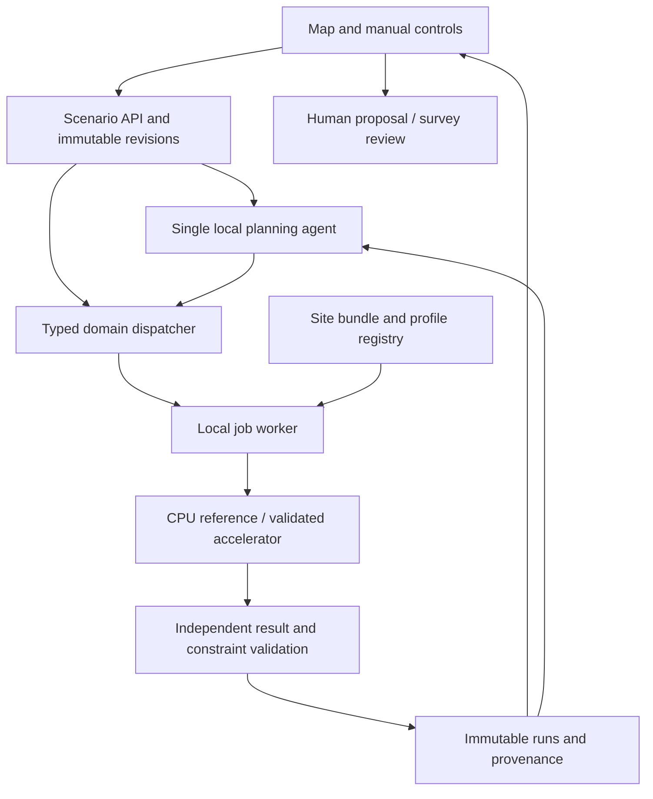

# Product and architecture specification

**Status:** working baseline 0.1, not a claim of implementation or unanimous team agreement.  
**Maintainers proposed:** Ben — integration; Arnav — numerical meaning; Alex — user interaction.  
**Related:** [Contracts](CONTRACTS.md) · [Numerics](NUMERICS.md) · [Build](BUILD.md) · [Validation](VALIDATION.md).

## 1. Outcome and user

Help a park/site manager decide which tree-planting proposal deserves funding and professional survey. Given a georeferenced site, target use periods, candidate profiles, exclusions and budget, calculate additional useful shade and expose cost, winter effects and uncertainty. Let the user challenge a location or alter a constraint and see a properly recomputed result.

The initial park/playground user is a design hypothesis, not a completed customer interview. Sheffield is the first case study, not a permanent geographic limit. Preserve existing trees; core editing adds/moves/removes **proposed** trees only.

**Distinctive interaction:** “Why here rather than there, and does that still hold for younger crowns or protected winter sunlight?” Optimisation alone is not novel: TreePlanter already studies tree-location optimisation [1] in [Sources](SOURCES.md). Our proposed contribution is the inspectable, adaptive planning investigation around a sound evaluator. It needs comparative evidence.

## 2. Core requirements

Requirement IDs remain stable across code, tasks and tests.

- **R01 — trustworthy site:** import a versioned, rights-checked bundle; validate scale, orientation, semantics and context. Block physics if scale/north is unresolved. Expose missing survey conditions rather than inventing permission.
- **R02 — reproducible calculation:** compute existing conditions and a proposed layout using the same samples, periods and assumptions. Show additional geometric shade in m²·h for opaque crowns; label attenuation-equivalent and weighted metrics separately.
- **R03 — feasible alternatives:** provide a competent deterministic reference and best evaluated search result. Independently check exclusions, budget, count, spacing, pins and supported winter limits. Show actual cost/count; do not imply global optimality.
- **R04 — useful agency:** a real local open model chooses registered tools from observations. Interpret briefs, investigate and explain returned evidence; do not let it manufacture metrics or waive constraints.
- **R05 — controlled challenge:** distinguish relocation of one proposed tree with all others fixed from full redesign under a new exclusion/budget. State which comparison ran.
- **R06 — manual control:** the same tools remain usable without the model. Editing immediately invalidates the apparent currency of old results; late jobs cannot replace the active revision.
- **R07 — visible assumptions:** show establishment and target-horizon cases, leaf state, winter checks, provisional feasibility, sources and sensitive rankings. A scenario is not a prediction of survival.
- **R08 — evidence and export:** every displayed metric links to an immutable run; distinguish live/cached/recorded/development-fixture modes. Export only permitted assets and explicitly labelled coordinates, assumptions and survey requirements.
- **R09 — demonstrable local runtime:** record actual model/checkpoint/parser/runtime, physics device, inputs, versions and measured timings on Spark when available. Laptop operation is not Spark proof.
- **R10 — repeatable operation:** another teammate can follow tested setup and smoke instructions; errors/cancellation are honest; a known-good build and visibly labelled recovery path exist.

## 3. First delivery versus end-state

**First thin slice:** one site representation, one target, explicit time bins, an unchanged baseline, one parameterised proposed tree and a real numerical difference on the map. An authored synthetic scene is acceptable for initial engineering and must carry its provenance. One rights-cleared real Sheffield site is required before making real-site demonstration claims.

**Complete core:** the requirements above, including controlled relocation and redesign, growth/season cases, one adaptive local agent, deterministic validation and a repeatable demo. Implement maximal-benefit-under-budget first; minimal-cost-to-target follows on the same validated search surface. A heuristic target solution is not certified minimum cost.

**Not in the core:** full-city reconstruction; multiple runtime agents; shell/browser autonomy; tree purchasing or planting authorisation; live production hosting; billing/accounts; invented cooling, household savings, AQI or biodiversity numbers.

**Retained upgrade path:** weather-weighted direct exposure → validated radiant-comfort modelling; building solar gains → thermal/HVAC model → purchased energy → tariffs; separately model interception/runoff after clarifying rain-protection intent; evidence-based habitat/air-quality/carbon assessments; lifecycle cost and phased multi-site investment. Each needs its own inputs and validation. These remain ambitions, not deleted requirements or unsupported dashboard tiles.

## 4. Main journey and interface states

1. Select site; inspect readiness, attribution and known gaps.
2. Choose targets, usage periods, crown/growth cases, constraints and a budget basis. Review the structured interpretation of a natural-language brief.
3. Request evaluation/search. Show progress and allow cancellation; keep stale results visibly historical, not current.
4. Compare existing, reference and candidate layouts with units, actual spend/count, winter effect and provisional status.
5. Relocate one tree, ban a region or change budget. A view-only sun slider is visibly distinct from an analytical scenario edit.
6. Inspect a justified sensitivity comparison where relevant, then review the evidence-backed proposal/export.

Required visible states: incomplete site; editable draft; queued; running; stale; completed with candidate; completed with zero planting; target not met; tool failure; cancelled; provisional survey status; cached/recorded/fixture. Do not use one generic green “success” badge for these.

Existing/proposed/candidate/excluded/unknown categories need labels/shapes as well as colour. Provide keyboard/form alternatives to drag actions, accessible metric text, clear units and per-zone results. Do not infer occupancy or vulnerability from image appearance.

## 5. Small modular architecture



**Working stack default, to prove in B01:** Python backend, Pydantic schemas, FastAPI, NumPy, pvlib; React/TypeScript/Three.js frontend; local run metadata in SQLite plus content-addressed asset files; one local inference service through a narrow adapter. Exact Python/package versions, model and serving image are selected by an actual compatibility smoke, not this document. No library compatibility or installation is asserted here.

Keep one backend application with separate `site`, `physics`, `search`, `jobs`, `contracts` and `agent` modules. Long numerical work runs outside request handlers in a local worker process; use one bounded-concurrency worker initially. SQLite persists job identity/state; a process restart marks abandoned running work interrupted/failed instead of pretending completion. Do not add Redis, a distributed queue or microservices without a demonstrated need.

Planned source layout, **not existing files**:

```text
backend/src/tree_planner/{contracts,site,physics,search,jobs,agent,api}/
backend/tests/{contracts,physics,search,agent,integration}/
frontend/src/{api,scene,panels}/
frontend/tests/
docs/                         # this pack after one canonical migration
```

B01 chooses a concrete module/file layout and writes tested setup commands. Serialization is owned once in backend schemas; generate frontend types/OpenAPI, do not hand-copy competing interfaces. The UI may render illustrative shadows but only validated numerical runs populate analytical metrics.

## 6. Agent policy and loop

One adaptive investigator incorporates scenario translation, counterfactual explanation, deterministic readiness checks and a finite menu of sensitivity investigations. Parallel proposal/critic agents are deferred unless they outperform a strong deterministic comparator under measured resources.

Loop: interpret → validate accepted scenario → inspect matching evidence → choose next useful registered analysis → inspect result/error → validate claims → finish or ask for a consequential missing decision. A location challenge should trigger `compare_locations`; a newly accepted exclusion should trigger `search_layouts`; a fragile ranking should trigger `compare_scenarios`, not arbitrary extra chatter.

- Anchor work in an immutable accepted scenario. The model may persist a separately identified hypothetical revision for in-scope analysis, but cannot silently activate changes to hard constraints, priorities, horizon or budget. Hypothetical results remain labelled and cannot replace the accepted evaluation/search selection.
- A human's explicit structured edit/accepted brief is authority; a model-generated `approved=true` is not. Hypothetical analysis may explore alternatives without activating them; label it accordingly.
- Never skip deterministic readiness, finite-value, identity, cost and feasibility checks.
- Use only the domain tools in CONTRACTS. No arbitrary shell, network fetch, SQL or asset path supplied by the model. Imported descriptions are data, never instructions.
- Every numeric statement must cite a returned metric/result; unsupported environmental claims are refused or described as an unimplemented module.
- Stop on sufficient evidence, material missing input, user cancellation, unrecoverable tool failure or repeated identical no-progress actions. Do not invent success at a timeout. Execution deadlines are explicit per-job operational controls; no arbitrary global assistant iteration cap substitutes for completing work.

Store accepted scenario, validated result summaries, tool observations, errors and a short action rationale. Raw meshes stay outside model context. Preserve a trace of action/arguments/result IDs, not hidden chain-of-thought. Prune old narrative while retaining current constraints and provenance. No cross-project personal memory is needed.

## 7. Locality, permissions and resilience

Core numerical data and model inference run locally where claimed. No hosted account/backend, telemetry or uploading of site assets is a core requirement. Development downloads and expressly selected public-source retrieval are separate from runtime; do not add arbitrary agent browsing. Asset imports reject traversal, external URLs and executable content; dependency/model access uses normal authorised setup outside the product agent.

Share one Spark inference service and coordinate heavy numerical work. Measure cold start, warm inference, mask build, search and end-to-end latency with co-resident memory pressure. CUDA ray queries are not proof of RT-core use. CPU physics plus local Spark inference is a valid engineering option; whether it satisfies the event must be checked against actual rules.

Fallbacks: manual controls if the model fails; validated CPU solver if an accelerator fails; exact-input cache or recorded evidence visibly labelled if a live run fails. None substitutes for an unmet mandatory local-agent gate. Preserve the last known-good code/data/model manifest; no live deployment/restart or new external service is implied by this spec.

## 8. Definition of the product claim

The proposed claim is **“the system investigates tree-placement decisions using reproducible numerical tools.”** It is earned by an unfamiliar request causing the right real tool action with current results and intact constraints—not by scripted UI text or more agent names.

Evaluate against a competent manual interface and fixed workflow using the same tools and mandatory checks. Measure correct completion, constraint fidelity, unsupported claims, interventions, useful extra analysis and latency. If the agent adds no reliable value, retain the useful numerical product and narrow the agent claim. Documentation and arithmetic checks alone do not pass this test.
