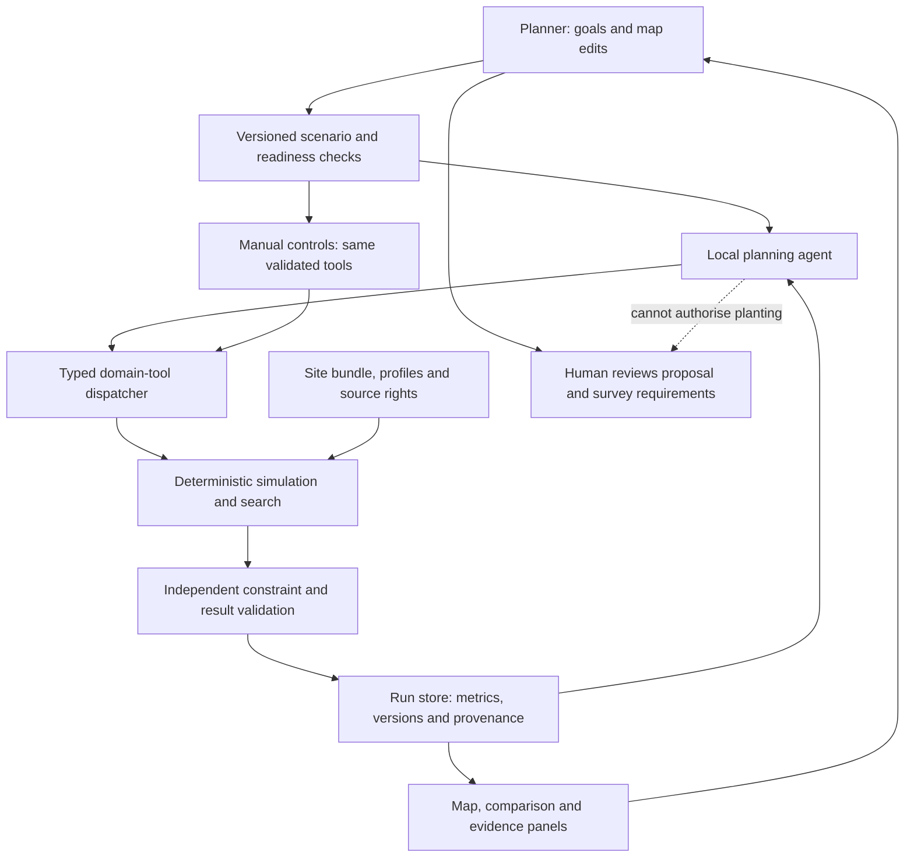

> **Historical research snapshot — not the active development specification.** The living entry point is [../README.md](../README.md). Its documentation-first/advance-development policy, contracts and task state supersede older planning/gating language below. This background copy preserves prior research/review reasoning; do not edit it as a second plan. No implementation is established by copying it.

# NVIDIA Hack for Impact: Sheffield — Comprehensive Project Handoff

**Audience:** Ben, Arnav and Alex  
**Document:** complete research, technical design, review findings and development justification  
**Version:** handoff 1.0 · based on team-plan revision 3  
**Prepared:** 11 November 2026  
**Status:** researched proposals for team agreement; no application or hardware execution claimed

This handoff is intended to stand alone. It includes the complete current technical design, not just a summary or pointers to earlier conversations.

### Document map

- [0. Purpose, evidence classes and how to use this handoff](#0-purpose-evidence-classes-and-how-to-use-this-handoff)
- [1. Recommendation: a planner that investigates its recommendation](#1-recommendation-a-planner-that-investigates-its-recommendation)
- [2. Event boundaries and preparation permissions](#2-event-boundaries-and-preparation-permissions)
- [3. Site readiness: geometry, semantics, rights and permission](#3-site-readiness-geometry-semantics-rights-and-permission)
- [4. Shading mathematics: what is actually calculated](#4-shading-mathematics-what-is-actually-calculated)
- [5. Optimisation, uncertainty and computation reuse](#5-optimisation-uncertainty-and-computation-reuse)
- [6. Agentic alternatives: usefulness and justification](#6-agentic-alternatives-usefulness-and-justification)
- [7. Recommended agent loop and action boundaries](#7-recommended-agent-loop-and-action-boundaries)
- [8. Architecture and closed investigation loop](#8-architecture-and-closed-investigation-loop)
- [9. Concrete integration contract](#9-concrete-integration-contract)
- [10. Technology choice and honest NVIDIA use](#10-technology-choice-and-honest-nvidia-use)
- [11. Three-person development strategy](#11-three-person-development-strategy)
- [12. Preparation now: concrete work packets](#12-preparation-now-concrete-work-packets)
- [13. Dependency-ordered build gates](#13-dependency-ordered-build-gates)
- [14. Verification and agent evaluation](#14-verification-and-agent-evaluation)
- [15. Demonstration: make the investigation visible](#15-demonstration-make-the-investigation-visible)
- [16. Risks, forgotten factors and the ambitious upgrade path](#16-risks-forgotten-factors-and-the-ambitious-upgrade-path)
- [17. Team decisions and next gate](#17-team-decisions-and-next-gate)
- [18. Work completed and the evidence behind it](#18-work-completed-and-the-evidence-behind-it)
- [19. Independent reviews, adopted changes and engineering judgement](#19-independent-reviews-adopted-changes-and-engineering-judgement)
- [20. Verification record and explicit proof limits](#20-verification-record-and-explicit-proof-limits)
- [21. Immediate team handoff: decisions, tasks and exit criteria](#21-immediate-team-handoff-decisions-tasks-and-exit-criteria)
- [22. Sources and evidence status](#22-sources-and-evidence-status)

## 0. Purpose, evidence classes and how to use this handoff

This document brings together the complete technical design, the research and review work that produced it, the reasons for the recommendations, the proposed team-development workflow and the outstanding decisions. Arnav and Alex should be able to understand the project without reading the earlier conversations or reconstructing separate AI sessions.

It answers two different questions: **what the team should build and why**, and **what preparation has actually been completed**. They must not be confused. The material is detailed enough to agree a build contract, but it is not a claim that the application exists or that every design decision has team approval.

### 0.1 The verdict

Continue with the tree-planning concept. The strongest version is an interactive planning investigator: a person specifies a site and constraints, receives physically evaluated alternatives, challenges a location or assumption, and sees the agent select the appropriate further analysis and explain the real result.

This is a systems/product opportunity, not a claim to have invented tree-placement optimisation. It can become more than a demonstration: a reusable site-analysis system leading to survey-ready proposals, later extended into phased canopy investment and independently modelled environmental benefits. The first real Sheffield location establishes a credible foundation; it should not permanently limit the product.

The strongest challenge to the proposal is a competent non-agentic planning application with structured controls, deterministic optimisation and automatic sensitivity checks. The proposed agent must show less user effort or better investigation on appropriate unfamiliar tasks without sacrificing numerical correctness. An LLM is not automatically useful simply because it is connected to tools.

### 0.2 Evidence vocabulary

- **Verified source fact:** a statement checked in primary documentation, source code or dataset metadata. This does not prove integration on our machines.
- **Observed execution:** a calculation, command or document check actually run during preparation, with its precise scope stated.
- **Derived mathematics:** equations and consequences of the declared model. They still need implementation and validation against the intended physical problem.
- **Proposed design:** a recommendation for team agreement, not a retrospective claim of approval.
- **Scenario assumption:** a declared hypothetical or uncertain input, not a measurement or probability estimate.
- **Unknown / blocked:** information or evidence not yet available.

The diagrams describe intended behaviour. The schemas describe required interfaces. The worked numerical examples use synthetic inputs. None of those is a disguised application execution.

### 0.3 Source of truth and version boundary

This is a standalone handoff snapshot of the current `Tree_Planner_Team_Plan.md`, revision 3, supplemented by preparation evidence and review outcomes. Sections 1–17 reproduce that design's substantive content; the later sections add the work record, reasoning trail and proposed task handoffs. References are collected at the end.

The canonical team plan remains the place to approve or change the design. Do not independently maintain this handoff, its PDF and the team plan as competing specifications. If the plan changes materially, regenerate the handoff or record an explicit amendment.

Both original independent reviews were supplied-text design reviews of the earlier technical inputs. The subsequent collaboration-workflow addition was integrated separately; neither reviewer is being represented as having freshly approved it. The proposed assignments, site and technology choices still need agreement by the people responsible.

### 0.4 What is ready and what is not

**Prepared:** recovered context, primary-source investigation, data/licence corrections, shading/search mathematics, agentic alternatives, review synthesis, interface/state design, team responsibilities, build gates, validation cases and document artifacts.

**Not established by this work:** a selected geometry-ready and rights-cleared site; a working application repository; an implemented simulator or optimiser; local model execution on Spark; measured site benefits; measured agent advantage; GPU speedup; organiser-rule confirmation; or team approval of all proposed roles and contracts.

The project is therefore **ready for concrete team decisions and gated implementation preparation**, not ready for deployment or judging. A successful document review is not a passed physical or software test.

### 0.5 Event context and practical constraints

The public event is NVIDIA Hack for Impact: Sheffield, Friday 13 November 2026, 09:00–20:00. The advertised themes are Economic Systems, Public Services and Urban Operations; this project fits Urban Operations, but the entered track has not been independently confirmed. The event emphasises real impact, technical execution including local agentic AI, and feasibility beyond the hackathon. Exact judging weights are unknown.[6]

The saved organiser-correspondence brief, checked 7 November, records Pendo at Eagle Works, 32 Cotton Mill Walk / Little Kelham Street, Sheffield S3 8DH; laptops and chargers should be brought, monitors are provided, and each team receives a Spark to use during the event. Hardware allocation for the day is not ownership of a prize. These logistics are project-record facts, not newly reconfirmed email correspondence in this handoff.

The recorded attendance plan is Friday only. Ben's registration was confirmed in the saved correspondence; individual teammate registrations, transport and whether the organiser has all requested team details still need their owners' confirmation. Private registration links and personal contact details are deliberately excluded.

The advertised event window is not an established coding cutoff. Exact submission time, demo duration, pre-event code/assets, AI-assistance rules and prior-work declarations remain decision gates. Public datasets are not a requirement to use unsuitable or restrictively licensed data. Previous winners illustrate what has been possible, not the team's odds of winning.

## 1. Recommendation: a planner that investigates its recommendation

Build a reusable, site-mesh-based **tree-planting decision investigator**. A planner supplies a real location, priorities, planting constraints and budget. The system evaluates alternatives, exposes the consequences and helps determine which proposal deserves funding and a professional site survey.

The first Sheffield case is a proof surface for the product, not a permanent one-site limitation. Existing trees are preserved by default; removal is not part of the core planting demonstration. The wider end-state remains an urban canopy investment and resilience platform, eventually connecting shade, weather, building energy, bills, rainfall, biodiversity and air quality through separately validated modules.

**Central interaction:** “Why this tree here rather than there—and does that recommendation survive younger trees, a protected winter-sun area or a changed budget?”

Three capabilities should distinguish the experience:

- **Understand the physical effect:** inspect the real site, existing obstructions, proposed crowns and computed direct-sun changes on the same map.
- **Challenge the decision:** move or pin one tree, exclude a region or change the budget. Distinguish a controlled location comparison from a complete redesign.
- **See what is supported:** every number belongs to an identified run with inputs, assumptions, units and execution provenance. Missing evidence remains visible.

The recommended runtime is **one planning agent with deterministic analytical tools**, not a committee of simulated specialists. Its useful autonomy is choosing the next relevant investigation from observations. Physics, costs, hard-constraint validation and result identity remain outside the language model.

**What would change this recommendation?** If a well-designed conventional interface and fixed workflow complete the same unfamiliar tasks more reliably, quickly and with less user effort, retain the useful numerical product and describe the agent as an accessibility layer rather than claiming analytical superiority.

**Current evidence:** research, live dataset metadata checks, source-backed software candidates, a mathematical specification and synthetic arithmetic checks. No imported real site, validated site solver, measured optimisation gain or live local agent has been established.

## 2. Event boundaries and preparation permissions

The official event page specifies Friday 13 November, 09:00–20:00, open-model agentic applications and local DGX Spark use.[6] The existing event brief records Friday-only attendance and the team Ben, Arnav and Alex. Individual registration, travel and team-detail submission should be checked by the relevant person; no new external action is implied here.

Impact, technical execution and practical usefulness matter. Exact scoring weights, presentation format, submission deadline and coding eligibility remain unverified. Do not use invented judging scores or assume every current feature of a previous winner was present in its winning prototype.

**Prepare now:** requirements, mathematics, interface design, source/licence audit, site-selection evidence, validation cases, runtime research, ownership proposals and demonstration design.

**Clarify before treating work as eligible entry material:** pre-event app code, prepared geometry/datasets, dependency and model downloads, AI-assisted implementation, reused open-source components and required declarations. Unknown rules do not mean advance work is prohibited. They do mean eligibility must not be invented.

**Requires actual device access:** model loading, tool-call reliability, Arm/native dependencies, device memory headroom, simultaneous inference/simulation and performance measurements.

Draft organiser question, not sent:

> What advance code, datasets, prepared geometry, dependencies and model downloads may we use, and may AI coding assistants help? What prior work must be disclosed? Please confirm the submission deadline/format, demo duration, repository and IP/licensing requirements, and whether any particular model, framework or GPU workload is mandatory. What software/model access is already available on the supplied Spark?

No public repository creation, publication, organiser message, booking or submission is authorised by this document.

## 3. Site readiness: geometry, semantics, rights and permission

The site must be more than an attractive mesh. The input is a reusable **site bundle**: geometry, geographic transform, semantic layers, tree profiles, constraints, provenance and known gaps.

### Live audit findings that change the preparation

- **Community Forestry Trees:** approximate planting records with species/site/date information, but no complete crown-width or height fields. The metadata identifies Open Government Licence terms. A record is not proof of a surviving tree with a known canopy.[12]
- **Community Forestry Tree Planting Areas:** groups planted since September 2019—not a map granting permission for future planting. It cannot become the plantable mask by renaming it.[14]
- **Street Trees:** indicative positions, not accurate surveys; the available fields do not establish crown geometry. Its metadata links INSPIRE licensing terms.[13]
- **The historical `schools.json` file:** School Localities, with administrative area names/codes—not individual school sites. Do not select a school from that file as if it supplied its grounds or building geometry.[16]
- **Parks & Countryside Sites:** useful site names and boundaries, but the metadata links the INSPIRE End User Licence.[15][17]
- **Licence gate:** the linked INSPIRE licence restricts use to personal, non-commercial purposes and prohibits redistribution without written permission. Do not assume these raw layers or derived public displays are freely publishable under OGL. Confirm suitable rights or replace the source before a shared/public entry. This is a source-licence warning, not a legal determination of every possible use.[18]

A live attributes query found named research leads including **Crookes Valley Park Playground**, **Ponderosa, Martin Street Playground** and **Ponderosa Playground**. Audit one of these rather than treating a name as a selected site. No geometry, planting permission, current canopy or public-redistribution clearance has been established for them.

### Recommended first decision

Use a park/playground manager as the initial user and compare shade for a clearly bounded, plausibly occupied target. Confirm a specific site only after the following gate; a school remains possible if its data and permissions are stronger. Choose by evidence quality and meaningful decision, not by the most dramatic render.

### Required site bundle

- **Coordinates:** latitude/longitude, horizontal CRS, vertical datum, local origin, metres-per-unit, true north, up axis and analysis-to-viewer transform.
- **Geometry:** terrain, buildings and existing vegetation, with capture date, source, classifications, dimensions, missing regions and context extent.
- **Semantics:** existing versus proposed trees; paths/access; target surfaces; planting masks; exclusions; protected winter-sun surfaces. A mesh alone does not identify permitted soil or underground utilities.
- **Tree profiles:** crown centre/base, dimensions/shape, trunk, seasonal leaf state, age/growth scenario, transmission assumption, cost basis and source.
- **Rights:** source, licence text, attribution, allowed reuse/redistribution, capture/retrieval dates and whether asset export is permitted.
- **Readiness:** blocking gaps, permissible provisional assumptions and survey-required conditions. Unknown scale or north blocks physics. Unknown utilities blocks real-world clearance, not necessarily an explicitly provisional scenario.

Separate the **study target** from surrounding **shadow-casting context**. For obstacle height H and solar elevation α, a simple flat-ground shadow extends H/tan(α). A synthetic 30 m obstruction at 5° casts approximately 342.90 m horizontally. This is not a prescribed buffer: it shows why winter context cannot be cropped arbitrarily. Check boundary sensitivity and include relevant terrain/horizon effects.

Existing trees baked into a mesh must not also be added as separate opaque crowns. A leaf-on scan cannot establish leaf-off winter behaviour merely by changing the date. Terrain, buildings and vegetation need distinguishable semantics or explicit limitations.

## 4. Shading mathematics: what is actually calculated

The first model is **direct-solar visibility/transmission**, not local air temperature, comfort, household savings or full radiation balance. Use an established solar-position implementation such as pvlib's documented interface rather than inventing astronomy code; provide geographic position and timezone-aware timestamps.[7]

### 4.1 Coordinates and solar direction

Use right-handed local **east x, north y, up z**, in metres. Let α be solar elevation above the horizon and A azimuth clockwise from true north. Trigonometric inputs are radians internally. The direction from a surface toward the sun is:

```math
s(t) = (cos(α) sin(A), cos(α) cos(A), sin(α))
```

A sun due south has negative north component; its shadow extends northward. Store user-facing `Europe/London` time zone and unambiguous UTC instants. Explicitly reject or resolve nonexistent/repeated local times at daylight-saving transitions. Do not treat naive local times as UTC.

Each sample i has position p_i, outward unit normal n_i, represented physical area a_i, target membership and a declared priority weight. Use surface area when terrain slope matters; distinguish it from planimetric map area. Partition overlapping target polygons or define one non-duplicating membership rule.

Cast a ray from the surface toward the sun:

```math
r_i(λ) = p_i + ε n_i + λ s(t),   λ > 0
```

Use a scale-aware self-intersection offset and/or originating-triangle exclusion; do not let the offset jump through nearby thin geometry. Night does not count as useful newly created shade. Back-facing surfaces have no direct incident sunlight even without an obstruction, so do not count that as a tree benefit.

### 4.2 Crown geometry and attenuation

**Recommended first crown:** a parameterised ellipsoid above a trunk, independently represented from the visual foliage. An opaque crown is a geometric scenario, not a claim that real foliage blocks all sunlight. A fixed crossing-transmission scenario is a transparent next step; a path-length model is a later refinement if its coefficients are justified.

For an ellipsoid with centre c and radii r_x, r_y, r_z, let D be diagonal with entries 1/r_x², 1/r_y², 1/r_z². A point q is inside when `(q−c)ᵀD(q−c) ≤ 1`. Substituting a ray gives:

```math
a λ² + b λ + c0 = 0
 a  = sᵀ D s
 b  = 2 sᵀ D (p−c)
 c0 = (p−c)ᵀ D (p−c) − 1
```

Here p is the actual offset ray origin. If the discriminant is non-negative, use the positive segment between the roots; the crown path length is `max(0, λ_plus − max(λ_minus, 0))` for a unit ray. Tangency and numerical tolerances need tests. Triangle/BVH intersection handles the static site; an analytic crown avoids constructing a detailed leaf mesh for each candidate.

Let B_it be transmission through the existing scene and T_ijt transmission through candidate tree j at sample i and time t. Both lie between zero and one. Under the explicitly simplified independent-attenuation model:

```math
V_it(S) = B_it × product of T_ijt over selected trees j in S
D_it(S) = B_it − V_it(S)
```

An opaque existing obstruction gives B=0, so a new tree behind it adds no direct-beam blocking at that sample. Opaque candidate masks combine by union, not addition. Partial transmission combines multiplicatively under this model; intersecting/interacting crowns require care about whether that approximation remains appropriate.

A possible homogeneous path-length model is `T = exp(−κ L)`, with effective extinction κ in inverse metres and crown path length L in metres. Do not invent species-specific κ values. This does not resolve scattering, individual leaves or multi-bounce light.

### 4.3 Useful shade and winter loss

For daylight interval duration Δt in hours and a dimensionless non-negative priority w, define f_it=1 only for a sun-facing surface. Added direct-beam blocking is integrated as:

```math
F(S) = sum over i,t of a_i × Δt_t × w_it × f_it × D_it(S)
```

With opaque crowns and w=1, the result is **additional geometric shade, m²·h**, over the stated target and period. With partial transmission it is **direct-beam blocking-equivalent m²·h**, not binary fully shaded area. With priority weights, call it weighted utility and also report the unweighted physical result. A score must not masquerade as extra physical area.

Use midpoint samples or another declared quadrature rule. Selected representative summer days are not an annual climate estimate. State evaluation dates, hours, sample spacing and which surface is shaded: ground, seating or another defined exposure surface.

Compute protected winter loss with the same expression over the appropriate winter surfaces and periods, with separate priorities. It represents lost direct sunlight, not extra heating demand. Prefer an explicit winter limit to a hidden coefficient allowing unlimited harm to be compensated by summer shade.

### 4.4 Irradiance and direct energy

If direct normal irradiance DNI is available and aligned with the evaluated instants:

```math
ΔE_i = (1/1000) × sum over t of
        DNI_t × max(0, n_i · s_t) × D_it(S) × Δt_t
```

DNI is W/m²; this gives kWh/m² of changed direct incident energy. Multiply by a_i and sum to obtain kWh over the sampled surfaces. Do not substitute global horizontal irradiance into this DNI formula. Diffuse sky light, reflection, longwave radiation and weather variability need separate treatment.

**The distinction is non-negotiable:** blocked incident solar energy is not building energy saved. A thermal/building model, systems and occupancy assumptions must bridge that gap before any purchased-energy or bill estimate.

### 4.5 Worked checks—not Sheffield results

Synthetic arithmetic checks executed during preparation:

- An 8 m vertical obstruction at 45° elevation gives an 8 m flat-ground tip shadow; at 30°, approximately 13.86 m.
- Let proposed opaque shadows cover cells 0–5 and 4–9, while cells 0–1 are already shaded. Their union adds eight 1 m² cells. Over two hours that is **16 m²·h**, not the 20 obtained by separately adding both trees' apparent contributions.
- For assumed existing transmission 0.8 and new-crown transmissions 0.5 and 0.25, combined transmission is 0.1; added blocking is 0.7. Those are illustrative coefficients, not measured foliage properties.
- DNI 800 W/m², horizontal ground, 30° sun and transmission 0.5 give 200 W/m² of incident direct energy rate; two hours give 0.4 kWh/m². No weather observation or benefit claim is implied.

These verify arithmetic and unit conventions only. They are not a ray-tracing implementation, real-site validation or hardware benchmark.

## 5. Optimisation, uncertainty and computation reuse

### Decision variables and constraints

Use a finite candidate library of **location/profile pairs**. Binary x_j selects candidate j. Alternatives at the same position are mutually exclusive. The catalogue is tied to site revision, profiles and assumptions.

Enforce:

- An explicitly chosen budget basis: upfront or lifecycle; never silently mix them.
- Tree-count limits if requested; permitted/provisional planting regions; exclusions; pinned choices.
- Pairwise spacing, access, root-space and crown-clearance conflicts, with the relevant age and clearance rule stated.
- At most one profile at a location; permitted species/profile rules where evidence supports them.
- Protected winter-sun thresholds and other user-approved hard requirements.

```math
sum_j cost_j × x_j ≤ budget
sum_j x_j ≤ maximum_tree_count
x_j + x_k ≤ 1  for each incompatible pair (j,k)
x_j ∈ {0,1}
```

Unknown utilities, ownership, soil and planting consent are **survey requirements**, not satisfied constraints. Call the result model-feasible/provisional, not construction-ready.

### Search policy

Start with deterministic marginal-benefit greedy selection followed by feasible add/remove/swap or relocation improvements. Generate a competent reproducible planting reference independently of the claimed winner. Use exact enumeration on tiny cases to check correctness; a more powerful solver is an upgrade when it improves measured results.

Overlapping shadows make benefit non-additive. Plain geometric coverage has useful diminishing-return structure, but spacing, costs, winter constraints and robust policies mean we cannot casually claim a general greedy optimality or approximation guarantee. Report **best evaluated layout**, search method and seed—not “globally optimal” without proof.

A common budget ceiling does not guarantee equal spend or tree count. Compare identical sites, profiles, dates, sample grids and constraints; show actual spend and count. If claiming equal cost or equal count, enforce that comparison. Report improvement over existing conditions separately from improvement over the competent planting baseline.

### Growth and robustness without misleading conservatism

Keep establishment/young, declared target-year and seasonal scenarios in the core contract. Do not give newly planted trees mature benefits. Leaf-off is not automatically transparent: branches and trunks remain.

Optimise a declared horizon and inspect uncertainty **within that horizon**. Show establishment performance separately; impose an early-benefit requirement only if the planner chooses one. Do not silently maximise the minimum across year 1 and year 20: that can collapse the decision into establishment-year shade and disguise the policy choice.

A max-min objective over a documented set of plausible same-horizon scenarios is an optional robust policy. It means best worst-case performance among those specified scenarios, not a probability guarantee or protection from every possible future. Show when layout rankings change across crown size, transmission, growth or survival scenarios. Unsupported probability distributions must not become confidence intervals.

Separate three uncertainties: numerical discretisation; uncertain input geometry/biology; and model inadequacy. Increasing ray count only addresses the first.

### Fast evaluation through reusable masks

For fixed scene, surface samples, timestamps and candidate profiles, precompute existing transmission B_it and candidate T_ijt. Search then combines masks rather than rebuilding/reraytracing the whole city for every layout. Opaque masks can use compact bitsets; partial transmission needs an appropriate numeric representation. This is exact for the stated discretised independent-attenuation model, not exact continuous physics.

Reuse requires compatible geometry/transform, sample locations/normals/areas, times, candidate positions/shapes/leaf state, attenuation model and numerical settings. A changed cost or budget may reuse geometric masks; a changed crown or evaluation time cannot reuse the wrong mask. New priorities can reuse masks only on the same spatial/time grid. Weather-only reweighting is possible when geometry/times stay fixed and the model remains direct-beam.

Illustrative storage calculation: 300 candidates × 5,000 samples × 24 times is 36 million entries—144 MB as float32 or 4.5 MB as packed binary, before metadata and additional scenarios. This is arithmetic, not a selected project scale or benchmark. Measure actual memory and runtime before choosing representations.

### Honest unsuccessful-search language

With only upper limits, the empty layout is normally feasible. “No trees can be added” is not automatically “the optimisation is infeasible.” Distinguish invalid inputs, no eligible candidates, no target-meeting layout found, cancelled work, solver failure and proven infeasibility of the exact finite model. A heuristic search failure cannot prove that no real-world planting arrangement exists.

## 6. Agentic alternatives: usefulness and justification

The comparison below is about different responsibilities and feedback loops, not simply giving bots different names. The strong baseline is a conventional interface with structured controls, deterministic optimisation, automatic mandatory checks and templated reports.

### A. Natural-language scenario translator

**Loop:** request → structured parameters → user review → fixed pipeline. Tools need scenario parsing/validation and the ordinary backend. Useful for accessibility and compound input, but most reasoning still sits in a fixed workflow. Failure: wrong units, invented defaults or altered constraints. Test parameter fidelity and effort against manual controls. **Decision:** useful foundation; insufficient as the headline capability.

### B. Adaptive planning investigator

**Loop:** accepted goal → inspect readiness/results → choose search, comparison or supported sensitivity test → inspect observations → recommend or ask a consequential question. The numerical foundations are constrained search and validated scenario comparisons. Useful when requests do not fit a fixed sequence. Failure: pointless repeated searches, unsupported explanation or silent preference changes. Test unfamiliar tasks against the same backend's strong fixed workflow. **Decision:** recommended central agent, with deterministic mandatory checks outside its discretion.

### C. Counterfactual and trade-off negotiator

**Loop:** challenge a location or requirement → identify the correct comparison → run it → explain trade-offs → ask which preference, if any, the human accepts changing. Two distinct tools are needed: hold the rest of the layout fixed and relocate one tree; or re-optimise the entire layout under a changed restriction. Useful for “why here?” and mixed stakeholder requests. Failure: changing multiple factors and claiming a controlled explanation, or relaxing a hard constraint without consent. **Decision:** first distinctive interaction, implemented as a capability of B rather than a separate model.

### D. Site-readiness and evidence investigator

**Loop:** inspect metadata → identify a consequential gap/contradiction → obtain an allowed source or request a measurement → update readiness. Useful for a reusable platform with heterogeneous site imports. Deterministic checks should handle known formats first. Failure: guessing north, treating image appearance as soil/utility evidence, or mistaking repeated sources for independent verification. Test against a checklist and known corrupted bundles. **Decision:** readiness tools now; autonomous source retrieval only after a governed evidence path exists.

### E. Adaptive experiment/model selector

**Loop:** observe a fragile ranking → choose a discriminating scenario or refinement → compare results → stop when the question is answered or a real input gap is reached. Foundations are sensitivity, convergence and ranking stability, not invented probabilities. Useful if a full sensitivity sweep is expensive. Failure: pursuing irrelevant precision or selecting a model without its required inputs. Test against a fixed sensitivity suite under comparable resources and result-quality requirements. **Decision:** a finite menu of supported sensitivity investigations first; open-ended fidelity selection later.

### F. Parallel proposal-and-challenge agents

**Loop:** independently generate candidate portfolios/objections → shared deterministic evaluation → request further work where observations justify it. Potentially useful with genuinely different evidence sources or search policies. Failure: correlated model mistakes, inconsistent assumptions, circular debate and memory/latency contention. The serious comparator is deterministic multi-start search plus validators, not one weak agent. **Decision:** not the initial runtime. Add only if controlled experiments demonstrate a net benefit. Simulated stakeholders do not replace actual consultation.

**Recommended combination:** B with C and a bounded set of E's analytical choices, using D's deterministic readiness tools. A remains the entry interface. F is an evidence-dependent research direction, not a way to inflate the apparent agent count.

## 7. Recommended agent loop and action boundaries

The agent owns investigation choices and explanations; the application owns identity, validation, permission and numerical truth.

1. **Interpret:** propose structured changes to goals/constraints. Ask only when ambiguity materially changes the decision. Routine analysis does not require repeated approval.
2. **Validate/readiness:** unknown scale/north blocks physics. Missing weather disables irradiance claims but can leave geometric shade available. Survey gaps keep the proposal provisional.
3. **Establish evidence:** evaluate or retrieve exactly matching cached baseline/reference/search results. Caching is allowed; concealing it is not.
4. **Choose the next investigation from observations:** a location challenge triggers a controlled swap; a new exclusion may trigger redesign; rankings that reverse under crown assumptions trigger comparison. Mandatory correctness checks cannot be skipped by the model.
5. **Handle failure honestly:** retain structured errors; retry only recoverable failures appropriately. Do not replace a failed simulation with plausible prose. Suggest relaxations, but keep them separate until a human accepts them.
6. **Validate and finish:** deterministic validators check constraints, finite numerical values, units and run identity. Present supported alternatives or a precise unresolved question.

Stop when the requested evidence is complete, a critical input/decision is missing, the user cancels, or the execution fails. Timeouts/cancellation are incomplete work, not success. Detect repeated no-progress actions; do not install arbitrary global worker/assistant iteration caps as a substitute for completion.

Proposed domain tools: `inspect_site`, `search_layouts`, `evaluate_layout`, `compare_locations`, `compare_scenarios`, `prepare_proposal`. A scenario-preparation operation validates proposed edits. Tool names are proposed API boundaries, not implemented functions. Lower-level solar calculations, coordinate conversion and ray kernels remain internal to these tools.

Visible trace: action, arguments, progress, observation, result ID and short evidence-backed rationale. It does not require private model reasoning traces. The model cannot execute arbitrary shell commands, invent costs, fetch arbitrary untrusted instructions, silently change hard constraints, send proposals, order trees or authorise planting.

Treat imported descriptions and retrieved documents as data, never instructions. Put numerical/source IDs in explanations; validate any quoted metric against its exact result. An export is a survey/planning proposal, not legal permission or an engineering sign-off. For GeoJSON, transform coordinates to the appropriate geographic representation; never emit projected metre coordinates as longitude/latitude.

## 8. Architecture and closed investigation loop



Use a small modular application, not a microservice estate: one Python backend with separated site/physics/search modules, an agent adapter and job dispatcher; one frontend; one local inference service. Keep long numerical work off the interactive request handler, with observable jobs, cancellation and supersession. A heavyweight distributed queue is unnecessary until a demonstrated requirement exists.

The manual interface and agent invoke the same tools. A model failure must not corrupt the numerical product, but manual operation does not satisfy the local-agent demonstration gate. Optional environmental modules must not prevent the core evaluator from starting.

## 9. Concrete integration contract

Agree the field meanings before independent development. Schemas below are design requirements, not executable code or fabricated API results.

### SiteBundle

- `site_id`, `scene_revision`, `geometry_fingerprint`, `semantic_revision` and asset references.
- `crs`, `vertical_datum`, `origin`, `units`, `true_north`, `up_axis`, `analysis_to_viewer` transform.
- Targets, plantable/provisional masks, exclusions, existing trees and protected surfaces, with source/revision/assumption status.
- Profile-library revision; geometry coverage/capture date; licence/attribution; readiness and survey requirements.

### ScenarioRequest

- `scenario_id`, `revision`, exact site/profile revisions; UTC instants plus local time zone; temporal quadrature and spatial resolution.
- Targets and physical area convention; usage weights with provenance; summer/winter periods; establishment and target horizon.
- Budget amount/currency/basis, cost/profile versions; hard constraints separate from preferences; pinned trees and objective policy.
- Allowed model/evaluator, numerical tolerances, scenario assumptions and search seed/configuration.

### Job and Result

- `job_id`, `run_id`, scenario revision, full input fingerprint and model/tool/evaluator/search versions.
- Status, progress, cancellation/supersession relationship and structured error details.
- Existing/reference/proposed layouts; baseline and alternative metrics with units, period, weighting and horizon.
- Per-constraint checks and explicit unknown real-world conditions; cost/count; numerical/sensitivity evidence.
- Execution mode (`live`, `cached`, `recorded` or development-only `fixture`), device separately for inference and physics, timestamps and timings.
- Assumptions, limitations, source IDs and coordinate metadata for permissible exports.

Job states: `queued`, `running`, `completed`, `failed`, `cancelled`, `superseded`. Analytical outcomes additionally distinguish `feasible_candidate`, `feasible_zero_planting`, `invalid_input`, `no_eligible_candidates`, `search_exhausted_without_target` and `proven_infeasible_finite_model` where justified. Do not conflate job completion with successful planning.

**Stale-result rule:** any scenario edit immediately marks previous results stale. An old job may complete into history, but cannot overwrite the active scenario. A cached result is reusable only when the relevant fingerprint matches; report the original computation and new retrieval separately.

## 10. Technology choice and honest NVIDIA use

Proposed default if the team has no stronger existing preference: Python numerical backend with typed schemas, a lightweight API, NumPy-based reference checks and pvlib solar positions; a TypeScript 3D web interface such as React/Three.js. Freeze exact libraries only after checking imports, licences, transforms and a real smoke path. Do not introduce infrastructure merely to look production-like.

**Physics representation:** retain the reusable 3D mesh contract. Compare generic mesh ray intersection with a 2.5D terrain/surface representation if the selected site supports its assumptions. A heightfield can be simpler for ground shade, but it cannot generally represent overhangs, bridges or multiple surfaces at one horizontal location. A visually convincing mesh can still be an invalid analytical model.

**Computational path:** small CPU reference → fixed-scene candidate masks → vectorised/packed-mask search → optional CUDA batching. Measure the bottleneck before adding GPU-specific complexity. NVIDIA Warp documents CPU/CUDA execution and mesh-ray queries.[8][9] Its installation guidance includes Linux AArch64 packages and Spark instructions.[10] Consider its documented limitations when selecting a backend.[11] It is a concrete candidate to test, not a verified project dependency.

Spark's RT cores are real hardware.[2] A CUDA ray query does not by itself prove use of those RT cores. Keep OptiX/other native integrations optional until compatibility and end-to-end benefit are demonstrated. Benchmark build/warm-up, mask generation, search and total request time separately; compare equivalent workloads and precision.

**Local model:** use a documented Spark Nemotron route rather than guessing a checkpoint/parser combination.[4][5] Pin checkpoint revision, quantisation, serving image/runtime, tool parser, context settings and licence together. The current playbook includes different model families/routes; do not silently assume that a multimodal Nano recipe establishes compatibility for a different text-only checkpoint.

Choose the smallest supported configuration that passes the actual tool-use tests with acceptable measured latency and memory headroom. Larger is not automatically better. Do not copy a large model from NeMo-Ray simply because it is a winner's repository.[3]

Share one inference service on Spark. Coordinate heavy numerical jobs, avoid competing weight reloads, and measure inference and physics concurrently. Unified memory is not infinite memory. Record model-download/cache readiness, disk availability, cold-start time, network/auth requirements and an offline path if permitted. No secret or API key belongs in the repo, screenshot or handoff.

**Fallback ladder:** validated CPU physics with local Spark inference; a simpler site representation only if its assumptions pass validation; a clearly labelled exact-input cached replay if live execution fails. Cloud inference is not a substitute for a claimed local run. A recorded demo remains recorded evidence, not a live pass.

## 11. Three-person development strategy

These assignments are proposed for Ben, Arnav and Alex to confirm. They allocate decisions and proof, not just files. All three should understand the full request-to-result path.

### Ben — scenario, agent and integration owner

Own request/result schemas, state/version identity, tool dispatcher, job lifecycle, local model adapter, structured errors and end-to-end integration. Implement the manual API path before making the model its only caller. Coordinate packaging and one shared working run.

**First delivery:** one validated request reaches a real numerical function and returns an identified result that the UI can display; then one actual local model call selects a valid registered tool. No invented fixture numbers may be reported as simulation output.

### Arnav — physical model and numerical-evidence owner

Own site suitability review, coordinate conventions, solar/canopy models, evaluation metrics, reference cases, uncertainty semantics and search correctness. Deliver the evaluator independently before a complete optimiser. Own physical truth even if implementation help is shared.

**First delivery:** a reviewed site manifest and a reproducible baseline-versus-one-tree calculation after analytic tests pass. A zero improvement is a valid result. Then expose candidate masks and feasibility rules so search need not wait for an entire monolithic simulation stack.

### Alex — decision workflow and spatial interaction owner

Own site import/view transform, target/exclusion editing, existing/proposed distinction, manual controls, comparisons, readable metrics, source/assumption panels and demonstration interactions. Explicitly labelled fixtures can unblock interface work after eligibility is established; they are never evidence.

**First delivery:** load the agreed scene and show a real result under its exact scenario revision, including stale/error states. Pair with Arnav to confirm one known point, north direction and crown size appear consistently in both systems.

### Avoid overloading one lane

Arnav's lane contains multiple critical dependencies. Split its deliverables: site manifest, evaluator, masks, search, then robustness. Once the evaluator/candidate contract is stable, Ben can implement the search/job wrapper against Arnav's specification, with Arnav reviewing numerical semantics. Alex can own spatial-layer editing and import QA, with Arnav signing off physical meaning. These are proposed handoffs, not unagreed reassignment.

If AI implementation is allowed, use it for bounded modules and tests while the named human owner checks assumptions and acceptance evidence. Faster code generation does not create trustworthy geometry or rights. Keep shared contracts single-owner; submit proposed changes rather than silently editing both ends.

### Mandatory integration pairings

- **Arnav + Alex:** verify analysis/viewer coordinates, units, tree dimensions, target areas and visual-versus-computational shadows.
- **Ben + Arnav:** one input fingerprint and real result through the numerical interface; constraint failures and unit checks.
- **Ben + Alex:** job progress, cancellation, errors, cached labels and an edited scenario that rejects stale results.
- **All three:** run the same complete scenario at each gate; record what actually passed. No three isolated prototypes joined at the end.

### Team engineering workflow — integrated from the master handoff

**Status:** proposed, awaiting team agreement. This applies to the AI tools helping the three developers build the application. It is distinct from the application's planning agent in sections 6–7. Several development agents do not imply that the product should contain several runtime agents.

Adopt the handoff's common source of truth, scoped ownership, small reviewed changes and evidence gates. Do not restart concept selection or recreate the entire nine-phase document hierarchy: the tree-planner direction is already selected, and this plan already contains the product, mathematics, architecture, responsibilities and acceptance requirements. Add precision where implementation needs it, not another set of competing summaries.

### Minimum documentation and authority

Until an authorised shared repository exists, this Markdown remains the current design; the PDF and ZIP are derived handoffs, not independently editable specifications. After repository owner, visibility and access are agreed, migrate the canonical source once and point old locations to it. Do not maintain a laptop plan and a repository plan with separate edits.

Proposed repository responsibilities, not files created by this update:

- `README.md`: short navigation, current milestone, setup entry point and links to the authoritative plan and runbook.
- One team-plan document: retain this product/design/validation content instead of splitting it into nine mandatory specifications. Split a section only when a real ownership or maintenance need appears.
- `contracts/`: the agreed machine-readable schemas and explicitly labelled development examples once implementation is permitted. The implementation schema becomes authoritative for serialization; document meaning and units alongside it rather than duplicating incompatible field lists.
- Project-root `AGENTS.md`: concise shared development restrictions, approved-contract links, test/reporting rules and escalation path. This is not permission to edit anyone's personal agent/profile instructions.
- A short decision/risk section or file: decision ID, question, selected alternative, rationale, status, accountable owner, approver and related change; risks add consequence, trigger, mitigation and fallback. No invented likelihood percentages.
- One runbook/evidence document: verified environment and Spark startup, smoke path, known-good build, recovery, demo and claim ledger. Do not invent runnable commands before they have been tested.

Distinguish **verified fact**, **assumption**, **proposal**, **accepted decision**, **deferred** and **superseded**. A human-approved task may explicitly authorise exploration against a named draft; merely reading a draft does not make it binding. Approval is attached to scope and revision, not an unqualified document badge.

### Decision and integration ownership

Ben is proposed as integration coordinator and contract-change coordinator; Arnav owns scientific semantics; Alex owns interaction/demonstration readiness. Shared contract changes require the affected producer and consumers to agree; changes to the principal metric, core scope, scientific method or submission readiness require team agreement. Ordinary internal implementation details remain with the component owner.

The integration coordinator protects the working baseline, but is not automatically the author or sole reviewer of every change. Changes to contract, dependency lockfiles, environment settings and shared integration code need a single identified writer at a time. Do not let two agents independently fix a shared file.

For a contract change: propose the exact delta and affected consumers; record approval/version; land the compatible contract with coordinated producer/consumer changes or adapters; explicitly notify the other lanes; run compatibility and end-to-end checks. Do not knowingly merge a new schema alone while leaving `main` broken.

### GitHub, MCP and actual communication

GitHub Issues/PRs can hold durable tasks and technical discussion; a Projects view is optional and should derive from those records rather than become a separate manual dashboard.[20][21] Urgent blockers need direct teammate communication, with the resulting decision recorded afterwards.

The official GitHub MCP server exposes repository, issue and PR operations through supported clients and configured permissions.[19] It is an optional access mechanism, not shared memory, automatic checkout synchronisation, an agent scheduler or guaranteed comment notifications. No GitHub MCP connection for this team has been established here. Start with ordinary Git/GitHub operations if connector setup adds friction.

Ben's proposed coordination responsibility includes explicitly revisiting blocked tasks after a dependency lands. Each worker must refresh the assigned issue, approved contract revision and local base before resuming. A new GitHub comment alone does not prove a running agent saw it.

### Branch, review and stable-build policy

- Use one shared repository after explicit creation/access approval; keep `main` at the latest integrated, smoke-tested state. Confirm visibility and asset rights before any publication; a private repository does not waive a dataset's sharing restrictions.
- Use short task branches and **separate clones or worktrees** for concurrent agents. Different branch names inside the same working directory are not isolation. Stage only owned paths and preserve unrelated changes.
- Once publication is authorised, open changes as draft PRs with no reviewers automatically requested. Ready-for-review transitions and reviewer requests need the agreed approval; this handoff does not grant it.
- Ordinary changes receive a quick relevant-owner/second-person review and affected checks. Shared contracts involve producer and consumers; scientific changes require numerical review. Review the final diff, not an earlier version with later unreviewed edits.
- Integrate in dependency order; recheck the merged state, not just the isolated feature branch. Commit, push, PR, green CI, merge and integrated runtime verification are different receipts.[20]
- Protect shared history: no force-pushing shared branches, direct unreviewed `main` changes or destructive cleanup. Branch protection can enforce reviews/checks, but its availability/settings need verification and authorised configuration.[22]
- Preserve the known-good commit and its matching data/model/dependency manifest. Set feature freeze relative to the actual submission deadline—not the advertised event end. During stabilisation, admit necessary fixes, not speculative features or dependency upgrades.

Repository creation, remote pushes, issue/comment publication, PRs, merges, permissions changes, new service connections and public release require explicit authority for the named actions. Teams may agree bounded standing permissions; no such permission is implied by this proposed workflow. No GitHub state was changed during preparation.

### Task packets and completion evidence

Each work item needs: one human owner; objective; approved specification/contract revision; starting commit; allowed and shared/forbidden paths; inputs/outputs; dependency IDs; acceptance checks; side-effect permissions; and the blocker/escalation route. The worker should inspect existing code before implementing, not independently choose a new architecture. Do not turn “build the simulation” into one unreviewable assignment: use the staged evaluator/mask/search handoffs above.

Completion reports identify changed files, dependencies, exact commands and observed results, checks not run, interface changes, limitations and commit/PR handles where they actually exist. An AI's assurance is not execution evidence.

Use one status record per task: **Ready → Active → Review → Integrated → Verified**, with **Blocked** or **Deferred** when appropriate. Integrated means merged into the shared baseline; verified means its required checks passed on the stated revision/environment. A closed issue or successful HTTP response is not sufficient proof. Avoid copying task statuses into a separate spreadsheet or dashboard.

At each short integration checkpoint, each lane supplies: what works with a receipt, what changed, current contract/base revision, next action, blocker and help needed. The coordinator resolves the dependency, not a lengthy meeting ritual.

### Lightweight traceability and claim control

Link each consequential requirement to its task/change, verification and demonstration claim. A claim ledger entry records claim ID, calculated/modelled/scenario/measurement status, input and run/commit identity, value and unit, environment, assumptions, limitation, reviewer and whether the team permits it in the pitch. Model-generated explanations are not verification.

Risk-based testing is not a licence to defer invalid units, hard-constraint breaches, stale results or fabricated-output paths as “secondary edge cases.” Conversely, documentation-only changes do not require a GPU benchmark. Run the affected check; broaden for demonstrated risk.

Run Spark/model smoke work in parallel with the first portable numerical slice as soon as access permits. Do not wait until an otherwise complete product to discover that local inference fails. A reduced-resolution/timestamp fallback changes the model's numerical evidence: label it, rerun the relevant convergence/acceptance checks and compare like with like. It cannot silently inherit higher-fidelity claims.

## 12. Preparation now: concrete work packets

The proposed preparation period is 11–12 November; these are tasks, not scheduled background jobs. Research/design is underway. Entry implementation, assets and downloads remain subject to clarified eligibility.

### Packet A — site and rights, Arnav with Alex

Choose one research lead, verify lawful reusable geometry and contextual coverage, identify current trees and missing dimensions, record licence/capture dates and map the target. Produce a manifest that says which coordinates, masks and profiles are measured, derived or assumed. If it fails, choose another audited site rather than fabricating geometry. A licensed parameterised scene can be a fallback validation case, but must not be called a real Sheffield reconstruction.

### Packet B — contracts and scenarios, Ben with both teammates

Approve section 9 field meanings and section 4 units. Specify one main user request, a location challenge, a forbidden-region redesign, a younger-canopy test and a missing-data/failure case. Define which constraints are hard and who may change them. Prepare design-level sample messages without invented runtime results.

### Packet C — mathematics and validation, Arnav with Ben

Agree opaque versus partial first crown semantics, sun conventions, evaluation periods, represented areas, tree profiles, cost basis, reference layout and final-layout recheck. Turn section 14 into executable tests once coding is permitted. Keep the worked arithmetic as reference expectations, not a substitute for the solver.

### Packet D — interface storyboard, Alex with Ben

Design the map-led flow: select target → inspect readiness → request proposal → compare → challenge → inspect evidence → review export. Include zero-gain, failure, provisional feasibility and stale states. Do not create visually present but numerically unsupported environmental tiles.

### Packet E — runtime/rules, Ben coordinating

Draft and obtain organiser clarification through an approved sender. Research the exact model/runtime path, staged dependencies, file access and shared Spark network setup. Record what is already supplied versus needing permitted download. Plan a minimal inference/tool smoke test and independent numerical smoke test before integration.

### Packet F — actual user value, all three

If someone can speak to a relevant planner or site manager, ask what decision they currently make, what information would change it, which constraints cannot be negotiated and what a useful survey/export brief must contain. Do not invent interviews or adoption evidence. A coherent user hypothesis is acceptable until checked.

**Already completed as preparation:** source and licence audit; concrete data misidentifications found; shading/search mathematics; six agentic alternatives; three-person dependency strategy; proposed Git/PR/development-agent workflow; synthetic arithmetic checks; source-linked runtime options. **Not completed:** site selection/readiness, team agreement, organiser clarification, runtime testing or any real project simulation.

## 13. Dependency-ordered build gates

This is an internal sequence, not an official event timetable. Use the confirmed submission deadline to reserve integration and rehearsal time. Ambition is retained through upgrades to one working path, not simultaneous unfinished modules.

### Gate 0 — legal and physical readiness

Agree the user, eligible inputs/work, chosen site, rights, transforms, first target, profiles and cost/horizon basis. Confirm owners and contracts. Begin the model/runtime smoke independently so hardware risk is discovered early. **Proof:** reviewed manifest and an explicit list of unresolved provisional conditions, not just a successful file import.

### Gate 1 — smallest truthful vertical slice

Baseline site → one parameterised tree → computed difference → UI. Use the same physical scene and revision across components. Analytic geometry checks precede trusting the real-site result. **Proof:** reproducible values with units, exact inputs, and an edit that makes old metrics stale. Search and polished AI explanations are not prerequisites.

### Gate 2 — real decision engine

Candidate generation, feasibility, competent reference, greedy/local improvement and independent final validation. Add establishment/target-year and winter evaluations needed by the stated promise. **Proof:** comparison under identical assumptions, actual cost/count, no constraint violations and honest unsuccessful-search statuses.

### Gate 3 — actual local agent

The local model selects a registered analytical action, the backend executes it and the explanation cites the returned result. **Proof:** model/runtime identity, tool arguments, run ID and execution trace—not a scripted UI imitation. The manual path remains available.

### Gate 4 — investigate a challenge

Support a controlled location comparison and a full redesign after a new restriction. Add a supported sensitivity investigation where observations justify it. **Proof:** correct branch, preserved accepted constraints, fresh-or-explicitly-cached results and a validated explanation. No staged discovery presented as spontaneous analysis.

### Gate 5 — repeatable delivery

Exercise clean setup, exact dependency/model versions, failure/cancel/stale behaviour, complete demo and permissible export. Measure latency and any acceleration claimed. **Proof:** someone other than the component author can run the documented path; remaining limitations are visible.

Do not call a fallback “complete” if it fails a mandatory event requirement. Do not delay the first integrated calculation until optimisation, GPU acceleration and elaborate UI are all finished.

## 14. Verification and agent evaluation

### Geometry, physics and numerical tests

- [ ] Known metre scale, true north, up axis and viewer transform; a known point round-trips correctly.
- [ ] Empty scene, wall occlusion, cardinal sun directions and H/tan(α) reference shadow.
- [ ] Crown tangent/miss/hit, trunk, self-intersection and near-grazing cases.
- [ ] Existing shade contributes no new benefit; duplicate/overlapping shadows do not double-count.
- [ ] Daylight/back-facing handling; timezone/DST edge cases; correct area/hour/energy units.
- [ ] Leaf/growth scenario changes invalidate incompatible masks; baked vegetation is not duplicated.
- [ ] Spatial and temporal refinement separately tested; report metric and ranking changes.
- [ ] Context expansion tested, especially low-sun winter conditions; missing-horizon limitations visible.
- [ ] Independent solar/shadow comparison or time-stamped observation where available; a renderer alone is not field validation.

### Search, costs and identity tests

- [ ] Exclusions, spacing, count, budget, pinned trees and winter limits independently checked on final layouts.
- [ ] Compare against a competent reference with the same cap/assumptions; show actual spend/count.
- [ ] Small exact reference instances expose search errors; no unjustified global-optimality claims.
- [ ] Empty feasible solution, absent candidates, missed target and proven finite-model infeasibility distinguished.
- [ ] Same-input reproducibility with declared tolerances; all versions and seeds recorded.
- [ ] Cost horizon/price year/discount basis explicit; no annual benefit extrapolated from selected days without a model.
- [ ] Superseded job cannot overwrite current state; cached/recorded/fixture/live modes cannot be confused.

### Agent tests against a strong baseline

Use the same backend and acceptance requirements for a manual interface, fixed workflow and adaptive agent. Include held-out requests, not only rehearsed wording:

- A well-specified ordinary request where the fixed workflow should perform well.
- A compound request with one genuinely ambiguous hard/soft requirement.
- “Move this tree” versus “ban this area and redesign everything.”
- A budget reduction with a protected priority that must not silently change.
- A proposal whose ranking changes under plausible crown scenarios.
- Missing north/scale versus missing optional weather.
- A tool failure, an impossible requested target and an irrelevant request for unsupported household savings.
- An edit made while an old run is still completing.

Record correct task completion, interpreted-constraint accuracy, unsupported claims, human corrections/actions, useful additional analyses, tool errors and total latency. Safety-critical invariants must pass; performance improvements are measured rather than invented. No agent advantage is assumed in advance. Include all relevant manual interaction time, and do not weaken the deterministic comparator's mandatory checks.

### Hardware and operational proof

- [ ] Actual checkpoint/revision/parser and serving runtime recorded; inference is local where claimed.
- [ ] Numerical device recorded separately; CPU/GPU comparators use equivalent workloads and precision.
- [ ] Cold start, warm latency, peak coexistence memory and job cancellation measured.
- [ ] A failed local model cannot leave a “live agent completed” badge.
- [ ] Export includes permissible assets/coordinates, provenance, assumptions and survey requirements; no secrets/private data.

## 15. Demonstration: make the investigation visible

The central visual should be the real site, not a chat transcript. Show existing conditions, proposed tree geometry, target surfaces, shadow/time controls and compact comparable metrics. A time slider is a view control unless its new state is actually evaluated; never imply that a rendered shadow is a newly validated analytical result.

Recommended sequence:

1. Explain one person's decision: allocate this planting budget to useful shade in this specific space.
2. Show readiness and current conditions, including assumptions and establishment/target-year distinction.
3. Request a plan; show existing/reference/best evaluated alternatives, units, actual spend and winter effects.
4. Challenge one position: hold the rest fixed and explain the counterfactual difference and feasibility.
5. Exclude a region or revise the budget: the agent chooses full redesign while preserving accepted priorities.
6. Where evidence warrants it, inspect sensitivity. If the ranking is stable, say so; if it changes, show why. Do not guarantee a dramatic reversal.
7. Open the action/result trace and device/runtime evidence, then review a survey-ready proposal.

For “why here?”, a leave-one-out or swap contribution is contextual. Individual contributions need not sum to total benefit. A geometric explanation should cite computed blocked rays/target changes, not plausible general statements about trees.

Keep interface distinctions accessible: colour plus shapes/labels; keyboard alternatives to spatial editing; readable metric lists; clear selected/candidate/excluded/unknown states. Show distribution by relevant zone instead of hiding everything inside one total. Do not infer vulnerability or occupancy from appearance.

The demo succeeds when an unfamiliar challenge leads to the correct analytical action and a real supported result. A truthful “no qualifying layout found” can demonstrate competence better than fabricated success.

## 16. Risks, forgotten factors and the ambitious upgrade path

### Highest-consequence omissions to prevent

- **Planting reality:** utilities, rooting volume, soil contamination/compaction, drainage, ownership, permissions, protected vegetation, emergency/accessibility routes, sightlines and maintenance/watering access. Professional review remains necessary.
- **Biological time:** establishment delay, drought/watering, mortality/replacement, species/site suitability, mature crown/root conflicts, leaf-off branches and existing-tree condition. A living-tree geometric scenario is not a survival forecast.
- **Competing benefits:** winter daylight and solar gains, solar-PV obstruction, play/sport use, visibility and unequal distribution of shade. Make supported trade-offs explicit; not all should be reduced to money.
- **Measurement limits:** outdated scans, missing off-site obstructions, leaf-on data, approximate tree positions and weather assumptions can dominate a small optimisation gain.
- **Operational risk:** model downloads/auth, package architecture, driver compatibility, shared-device contention, stale caches and last-minute integration. No hardware specification substitutes for a run.
- **Adoption:** a useful output has surveyed/provisional distinctions, editable proposals and interoperable coordinates, not just a beautiful animation. Data rights and future commercial use are separate from initial research access.

### Upgrade modules and the evidence they require

**Weather and radiant exposure:** direct DNI-weighted energy first; then diffuse/reflected/longwave modelling and validated mean radiant temperature/comfort. Shade alone does not prove local air-temperature reduction. TreePlanter/SOLWEIG is relevant prior art and a future baseline, not a verified integrated dependency.[1]

**Building energy and bills:** tree/scene exposure → façade/window solar gains → building thermal model → heating/cooling demand → purchased energy → tariffs. Representative building archetypes can support labelled scenarios. Many UK homes lack mechanical cooling; winter losses may increase heating. Report per-building and aggregate estimates only when those links are implemented. Standing charges do not vanish with reduced consumption.

**Water:** first clarify whether the requested rain protection means pedestrian shelter, canopy interception or runoff mitigation; these are different questions. Separate canopy interception, throughfall/stemflow, infiltration/runoff and harvestable water. Rain falling on a canopy is not retained water; interception is not drainage-network flood protection. Use appropriate rainfall, soils and drainage inputs before hydrological claims.

**Carbon, air quality and biodiversity:** separate stored carbon, annual sequestration, lifecycle emissions and energy-related avoided emissions. Pollution deposition is not automatically lower local concentration or AQI; airflow can matter. Species/native/habitat evidence can support suitability categories before any quantified ecological prediction. Do not invent biodiversity scores.

**Lifecycle investment:** include procurement, ground works, establishment watering, inspections, maintenance, replacement and removal where supported. Present-value cost can use `C0 + sum_y C_y/(1+r)^y`, with horizon, price year and real/nominal discount basis declared. Keep non-monetised benefits separate. Cost per shade-hour must name the represented periods; selected summer days cannot justify annual NPV. Model survival uncertainty explicitly rather than fabricating precise returns.

**Multi-site/phased planning:** once single-site validity is established, compare staged investments and shared budgets across sites/years, preserving per-zone outcomes and model readiness. This is the route to the broader investment/resilience product—not a reason to include unvalidated modules in the first demo.

## 17. Team decisions and next gate

Recommended defaults are proposals, not retrospective claims of agreement.

- [ ] **All three:** confirm the first user and core decision; keep the reusable site-based product and one real Sheffield demonstration.
- [ ] **Arnav + Alex:** nominate and audit one site plus an alternative; resolve geometry and redistribution rights before selection.
- [ ] **Arnav:** agree opaque/partial crown semantics, target/establishment horizons, evaluation periods and winter requirements.
- [ ] **All three:** choose cost basis, hard versus soft constraints, supported profiles and an independent competent baseline.
- [ ] **Ben:** freeze request/result identity and tool boundaries with both consumers; retain the manual path.
- [ ] **Ben + Alex:** choose the first counterfactual interaction and define how stale/provisional/cached results appear.
- [ ] **All three:** confirm lane ownership and the smaller staged numerical handoffs; avoid a single late simulation dependency.
- [ ] **All three:** name the repository administrator, integration owner and contract reviewers; agree visibility, access and explicitly permitted external agent actions before repository setup/publication.
- [ ] **Ben with both teammates:** confirm each coding tool can consume the same versioned task/contract; use ordinary Git/GitHub unless MCP adds demonstrated value. No connector setup is assumed.
- [ ] **Approved sender:** clarify event rules and submission/runtime logistics; no message has been sent by this plan.
- [ ] **Ben + Arnav:** select and smoke-test an exact local-model and numerical stack when allowed/access is available.
- [ ] **All three:** accept a gate only from actual output; record the next action, owner and unresolved condition.

**Next real gate:** a rights-checked site manifest and agreed contract, alongside a permitted runtime smoke path. Until then, this is a prepared design—not a competition-ready application. No selected-site benefit or performance number should appear in the pitch as measured.


## 18. Work completed and the evidence behind it

### 18.1 Existing project recovery and consolidation

The prior Sheffield research, event brief and consolidated team plan were recovered and compared with Arnav's project-research handoff and the later engineering-process handoff. The selected tree-planner direction was preserved; obsolete alternative concepts were not silently revived.

The original ambition was retained: useful shade and cost-aware planting first, with a route to energy/bills, radiant exposure, rainfall-related effects, ecology and public investment. The design was changed from a loose list of environmental promises into modules with explicit prerequisites and claim boundaries. That change is sequencing, not abandonment of the larger product.

The two team handoffs served different purposes: one supplied product/research analysis; the other supplied a development-coordination proposal. Their content was integrated into one plan, rather than creating a second authority for scope and interfaces.

### 18.2 Scientific prior art and originality

The TreePlanter paper was inspected, including its discussion of SOLWEIG inputs, hill-climbing search and comparison against a greedy algorithm.[1] This establishes relevant prior art for computational tree-location optimisation. It does not establish that TreePlanter is installed, compatible with Spark or suitable for our selected site's inputs.

**Consequence:** do not pitch generic tree-placement optimisation as new science. Differentiate through an operational planning workflow: explicit budget and physical constraints, adaptive investigation, controlled alternatives, transparent provenance and a usable path to professional review.

### 18.3 Previous winning project and actual agent mechanism

UCL confirms that its student team won NVIDIA Hack for Impact with NeMo-Ray, a digital twin for mobile-network coverage and infrastructure-failure response.[23] The current NeMo-Ray repository was also inspected at the pinned source revision linked in the references, rather than relying only on promotional descriptions.

The inspected agent implementation uses a repeated model-decision/tool-execution/observation loop. Its planner obtains structured decisions from a model endpoint; registered tools execute the requested analysis; observations feed the next decision. This is a concrete example of agency surrounding deterministic scientific tools.[3]

**What this proves:** a physical simulation can be a tool inside a genuine agentic application. **What it does not prove:** our specific agent is useful or reliable, the current repository was wholly present during the winning demonstration, or the source runs correctly on our eventual environment. No NeMo-Ray runtime was reproduced in this preparation.

### 18.4 Hardware and software feasibility investigation

NVIDIA's specifications confirm Spark's Arm CPU, Blackwell GPU and RT hardware.[2] Official Nemotron Spark playbooks were inspected to identify documented serving paths and the need to keep checkpoint, quantisation, runtime and tool parser compatible.[4][5]

Warp documentation provides a concrete CPU/CUDA mesh-query route to investigate, including Arm-platform installation guidance.[8][9][10] Its documented limitations still matter.[11] pvlib documents a solar-position interface and timezone requirements that fit the numerical design.[7]

**Consequence:** these are researched candidates, not tested integrations. A CUDA-based ray computation is not automatically an RTX/RT-core benchmark. A documented model checkpoint does not prove simultaneous model/geometry workloads fit the supplied Spark. The first hardware test remains a real local inference request and tool invocation, followed by coexistence and latency checks.

### 18.5 Dataset semantics and rights audit

Official item and layer metadata were examined rather than assuming that a file name described a usable scientific input. The consequential findings were:

- Community Forestry Trees records approximate planting information; complete canopy heights and widths are not supplied. A planting record does not prove that a living tree with those assumed dimensions exists today.[12]
- The historical planting-area layer describes previous planting groups. It is not permission for future planting and cannot serve as the permitted-area mask without a separate justification.[14]
- The previously saved school-related file is a School Localities layer. Administrative areas are not school buildings, grounds or confirmed playground boundaries.[16]
- Street-tree positions are indicative rather than a survey and do not supply a complete crown model.[13]
- Park records offer research leads, but a named polygon is not an imported, validated 3D scene or permission to plant.[15][17]
- Parks and street-tree metadata link a licence restricting personal/non-commercial use and redistribution. Public accessibility does not establish the right to redistribute raw data or include a derived display in every intended submission or product.[18]

**Consequence:** site readiness has four separate gates—geometry, semantic meaning, data rights and real-world planting suitability. Passing one does not imply the others. Candidate park/playground names remain research leads. No raw restricted GIS datasets are bundled into this handoff.

### 18.6 Mathematical and computational preparation

The work produced explicit conventions and equations for solar direction, ray visibility, ellipsoid crowns, existing-scene transmission, overlapping proposed crowns, direct-beam blocking-equivalent area-time, winter loss and direct incident energy.

It also defined finite candidate choices, hard constraints, fair baseline comparison, reusable masks, invalidation conditions, search limitations and named uncertainty scenarios. These are specifications and derivations. They are not executable solvers delivered under another name.

The executed arithmetic checks are listed in section 20. They protect simple reference expectations and units; they do not establish ray-intersection implementation correctness, measured canopy properties or real-site accuracy.

### 18.7 Architecture and workflow preparation

The plan now specifies the agent/tool boundary, manual fallback path, versioned requests, asynchronous job/result identity, stale-result prevention, execution-mode labels, human approval boundaries and independent numerical validation.

The collaboration handoff added separate worktrees/clones, scoped coding tasks, contract-change coordination, draft PR rules, evidence-based task states, early hardware checks and a stable-demo policy. GitHub pull requests and its official MCP server were researched as coordination mechanisms.[19][20]

GitHub Projects and protected-branch documentation informed the proposed workflow.[21][22] No shared repository, MCP connection, branch protection, hosted CI or team-access configuration was established by this work.

The preparation also produced the canonical Markdown, rendered PDF, original-review bundle and verification receipts. Document text, section coverage, diagram rendering and representative page layout were checked. Those checks prove artifact integrity, not application behaviour.

## 19. Independent reviews, adopted changes and engineering judgement

### 19.1 How the reviews were conducted

Ben requested separate Terra and Sol input as well as an independent main-session view. Two Codex review runs requested `gpt-6.1-terra` and `gpt-6.1-sol` using the ChatGPT subscription route. Both recorded exit code zero and a completed turn. They had different emphasis but shared the project inputs and limitations.

The main-session position was written before either report was read. Afterwards, the reports were compared with that position and with primary-source evidence. Agreement between models was not treated as experimental validation. The reviews were read-only supplied-text analysis: neither worker ran the application, inspected a real site or performed a new network-based audit.

### 19.2 Terra: numerical and engineering contribution

Terra recommended a reusable mesh-based planner built around a deterministic direct-sun evaluator and finite candidate search. It supported using the agent to formulate, challenge and revise the planning problem, while keeping the output an inspectable proposal rather than planting authorisation.

Important contributions adopted:

- Put canopy transmission, season, age and uncertainty into the core scenario representation even when initial values are simple. Otherwise later growth/winter work changes the meaning of existing results.
- Calculate change relative to the existing scene; do not add individual shadow areas as if overlap did not exist.
- Separate a common budget cap from equal actual spend and equal tree count. A comparison can be honest without being identical in all three, but its label must be accurate.
- Explain the conditions under which fixed candidate masks can be reused. Reuse is a mathematical modelling assumption, not a universal caching trick.
- Distinguish exact finite-model infeasibility from heuristic failure to find a qualifying candidate.
- Compare the agent against a competent ordinary interface using the same backend, not against a deliberately weak baseline.

**Why these matter:** they prevent an attractive demo from obtaining improvement through double-counting, incompatible assumptions or misleading comparison labels.

### 19.3 Sol: product, agency and coordination contribution

Sol recommended a planting decision investigator whose question is whether a proposal remains defensible when its locations, assumptions and constraints are challenged.

Important contributions adopted:

- “Move this tree” and “forbid this region and redesign the layout” are different experiments. The first holds other factors fixed; the second allows the rest of the plan to change.
- Agent usefulness comes from interpreting compound challenges and selecting relevant investigations—not merely converting a sentence into parameters.
- A useful output is a reviewable planting/survey brief, with unresolved site checks and alternative options, not just a map or generated narrative.
- A deterministic fixed sensitivity suite is a strong competitor to an adaptive experiment-selection agent. A multi-start optimiser is a strong competitor to multiple proposal agents.
- Local-model contention, prompt/state errors and unnecessary questioning can outweigh apparent sophistication. The agent must earn its place in a controlled comparison.

**Why these matter:** they turn the interface into a decision tool and provide a falsifiable justification for agency instead of relying on the word “agentic”.

### 19.4 Main engineering synthesis and disagreements

The final recommendation is not to deploy every suggested variant. Use one adaptive planner with controlled counterfactual and evidence-checking capabilities. Deterministic validators enforce mandatory correctness; the model chooses additional investigations from supported options when the observations justify them.

Specific judgements made during synthesis:

- **Do not automatically optimise the worst result across all tree ages.** Year 1 and year 20 answer different temporal questions. A blanket minimum can make establishment shade dominate without acknowledging that policy choice. Choose a target horizon, show establishment separately and test uncertainty within each horizon; impose early-benefit constraints only when the user wants them.
- **Start performance work with reusable geometry/masks.** This reduces repeated computation before choosing hardware-specific complexity. Add acceleration after measuring the real bottleneck; do not use RT branding as a substitute for proof.
- **Keep the broader ambition, but separate its models.** A reliable direct-sun core is a dependency for richer modules, not evidence that those modules already work or that they should be abandoned.
- **Avoid a multi-agent committee in the first runtime.** Independent development workers can still accelerate implementation. Product multi-agent complexity must show a gain beyond a strong single-agent or deterministic alternative.
- **Do not import a nine-document bureaucracy.** Preserve one current plan, concrete contracts and task-level evidence; split documents when a real maintenance need appears.
- **Treat new source discoveries as design constraints.** Misidentified layers and licence restrictions are not footnotes to fix after the demonstration; they affect which site and assets can be used at all.

There is no formal claim of unanimous approval of every proposed detail. The later workflow integration was not sent back through both workers as a new review, and a new round was not invented for this handoff.

### 19.5 What would change the verdict

- If a strong conventional workflow consistently completes the target tasks with fewer errors, less user effort and lower latency, position the agent as optional accessibility/orchestration rather than analytical superiority.
- If geometry or rights cannot be established for the preferred site, select a better-audited site. A parameterised teaching scene may support validation, but must not be presented as a real reconstruction.
- If a proposed GPU backend fails compatibility or offers no end-to-end benefit, retain the validated computational path and report the actual devices used.
- If the claimed user problem is not useful to a real planner, adjust the decision workflow rather than adding more environmental metrics to disguise the mismatch.

## 20. Verification record and explicit proof limits

### 20.1 Calculations actually exercised

The preparation record contains eleven passing checks. Their inputs are synthetic. Several check related parts of the same example, so they are not eleven independent physical validation experiments.

- **Check 1:** 8 m pole at 45 deg elevation: horizontal shadow metres — recorded value **8**; reference **8**; passed.
- **Check 2:** 8 m pole at 30 deg elevation: horizontal shadow metres — recorded value **13.8564064606**; reference **13.8564064606**; passed.
- **Check 3:** 30 m obstruction at 5 deg: illustrative context distance — recorded value **342.901569083**; reference **342.901569083**; passed.
- **Check 4:** Additional cells from overlapping crowns excluding baseline — recorded value **8**; reference **8**; passed.
- **Check 5:** Additional shade area-hours: 1 m2 cells, 2 h — recorded value **16**; reference **16**; passed.
- **Check 6:** Naive separate-crown sum overcounts area-hours — recorded value **4**; reference **4**; passed.
- **Check 7:** Fractional direct transmission through two assumed independent crowns — recorded value **0.1**; reference **0.1**; passed.
- **Check 8:** Fractional-equivalent direct shade increase, baseline 0.8 — recorded value **0.7**; reference **0.7**; passed.
- **Check 9:** Direct irradiance DNI 800 at 30 deg, horizontal surface, transmission 0.5 — recorded value **200**; reference **200**; passed.
- **Check 10:** That irradiance over 2h in kWh per m2 — recorded value **0.4**; reference **0.4**; passed.
- **Check 11:** 8-bit mask toy exact union cardinality — recorded value **8**; reference **8**; passed.

The low-sun context distance was also illustrated using a 30 m obstruction at 5° elevation; it is not a measured Sheffield building or an engineering buffer rule. The assumed transmission and DNI values in the examples are not field observations.

### 20.2 What these checks establish

They confirm the recorded arithmetic, basic flat-ground geometric expectations, overlap counting, simple assumed transmission composition and unit conversion. They provide useful expected values for future tests.

They do **not** establish an implemented ray tracer, full numerical convergence, accurate tree geometry, current weather, physical canopy transmission, optimisation quality, agent reliability, GPU acceleration or field outcomes. A scalar arithmetic assertion is not a scientific validation campaign.

### 20.3 Source and artifact verification

The source audit checked specific official pages, code and dataset metadata. Availability/status of an endpoint is not proof of complete site coverage, legal reuse for every purpose or suitability for simulation.

The handoff is generated from the verified current plan, rather than manually maintaining another copy of its mathematics and role assignments. Source integrity, section coverage, reference registration, rendered diagram and PDF text/layout are checked before delivery. No credential or private host path is needed to understand or use this handoff.

The earlier canonical plan's document QA and this handoff's document QA are separate from any future software test suite. No CI success, deployed service, physical test or competition outcome is being inferred from them.

### 20.4 Execution and publication status

No competition application was implemented in this preparation. No real-site benefit or runtime performance was measured. No shared repository was created, no team message or organiser reply was sent, no public data publication occurred and no entry was submitted. This does not establish that teammates have done no separate work; their current contributions should be reconciled at the next team checkpoint.

## 21. Immediate team handoff: decisions, tasks and exit criteria

### 21.1 Decisions the three teammates must resolve

The project direction does not need another broad concept-selection exercise. Resolve the concrete choices that affect implementation:

1. **First user and scenario:** which person is making which planting decision, over what target and time horizon?
2. **Site and rights:** which real location passes geometry, source-rights and semantic-readiness checks? What stays provisional until a professional survey?
3. **Metric and cost basis:** what exactly counts as useful shade, which winter/establishment requirements are hard, and is the budget upfront or lifecycle?
4. **Contracts and ownership:** who writes the shared schema, who reviews producer/consumer changes, and do Ben, Arnav and Alex accept the proposed lane split?
5. **Runtime:** which documented model/runtime and numerical route will be tested first, and what is the permitted fallback?
6. **Event and repository permissions:** what advance work is eligible, what needs disclosure, what is the actual submission deadline, and who may create/publish/change shared repository state?

Do not convert an unanswered item into a hidden default merely to start more parallel agents.

### 21.2 Proposed task breakdown, not existing GitHub issues

These labels identify candidate work packets; they are not claims that issues, branches or assignments already exist. Final paths and commands must come from the actual repository once authorised.

- **SITE — Arnav with Alex:** produce the site manifest, geometry/semantic audit, existing-tree assumptions, context extent and licence/attribution decision. Exit: a site is either explicitly analysis-ready at a declared fidelity or rejected with a reason. Blocks real-site claims, not analytic reference tests.
- **CONTRACT — Ben with both teammates:** agree request/result/site fields, units, revision identity and failure states. Exit: each producer/consumer understands the same contract. Any temporary development fixture is labelled and does not count as numerical evidence.
- **PHYSICS — Arnav:** implement solar-position integration and a baseline/one-crown evaluator after the relevant eligibility gate. Exit: analytic reference cases pass and a real computed result is returned through the contract.
- **DISPLAY — Alex with Ben:** show existing/proposed geometry and metrics from the actual result; verify the coordinate transform with Arnav. Exit: a changed scenario makes old metrics stale, and error/zero-gain/provisional states remain visible.
- **SEARCH — Arnav with implementation support from Ben as agreed:** generate candidates and conflicts, build the competent baseline and feasible greedy/local-improvement search. Exit: independently checked alternatives with actual cost/count and accurate search-status wording.
- **LOCAL MODEL — Ben:** establish one actual local inference and registered tool invocation on the permitted hardware/runtime. Exit: model/device identity, arguments and returned result are observable. Run this in parallel with portable work when hardware access permits.
- **INVESTIGATE — Ben with Arnav:** connect model decisions to controlled relocation, redesign and supported sensitivity tools. Exit: unfamiliar challenges select the correct analysis without silently relaxing accepted constraints or inventing results.
- **INTEGRATE — Ben coordinating, all three checking:** use one stable baseline, contract revision and complete smoke path. Exit: a peer can reproduce request → calculation → displayed result, and cancelled/superseded work cannot corrupt the active scenario.
- **DEMO — Alex coordinating, all three defending:** rehearse an unfamiliar challenge, preserve the known-good build, prepare evidence-backed claims and record limitations. Exit: live/cached/recorded modes are honest and the submission requirements are met.

The dependency is not “finish simulation, then begin frontend, then add AI.” Contracts and small analytic references unblock parallel work; the smallest real calculation connects the lanes early; search and adaptive investigation upgrade that working path.

### 21.3 Completion contract and immediate next move

The first decisive technical proof is **baseline site → one tree → correct computed difference → displayed result**. It is acceptable for that difference to be zero. The first decisive hardware proof is **local model → valid tool selection → actual result**. Neither can be replaced by a polished screenshot or documentation.

The next team checkpoint should choose the site-readiness owner and contract owner, settle the primary scenario, identify the approved organiser/repository actions and record the first proof each lane will deliver. After those decisions, the default should be implementation and measurement—not another broad planning cycle.

The resulting proposal remains decision support. Real planting still needs professional checks for utilities, access, ownership, ecological conditions, maintenance and consent. The wider environmental ambition remains valuable only when its additional models earn their claims.

## 22. Sources and evidence status

Links below support specific source facts, not blanket implementation claims. Dataset metadata and runtime documentation were checked during preparation; current repository code is not proof of the exact historical winning submission. Software suitability must still be established on the actual system.

Sources:

[1] [TreePlanter paper, SOLWEIG-based tree-location optimisation and algorithm comparison](https://gmd.copernicus.org/articles/15/1107/2022)

[2] [Official DGX Spark hardware, including Arm CPU and Blackwell RT cores](https://docs.nvidia.com/dgx/dgx-spark/hardware.html)

[3] [Inspected NeMo-Ray model/tool/observation loop, pinned source revision](https://github.com/Harrishayy/NeMo-Ray/blob/6b3dfdc06ffe9b846eca864fb87257151ed0f337/agent/nemoray_modelling/agent.py)

[4] [Official Nemotron on Spark overview](https://build.nvidia.com/spark/nemotron/overview)

[5] [NVIDIA Spark Nemotron playbook source](https://github.com/NVIDIA/dgx-spark-playbooks/tree/main/nvidia/nemotron)

[6] [Official Sheffield event](https://events.nvidia.com/Hack-for-Impact-Sheffield)

[7] [pvlib solar-position inputs and timezone requirement](https://pvlib-python.readthedocs.io/en/stable/reference/generated/pvlib.solarposition.get_solarposition.html)

[8] [Warp mesh-ray query API](https://nvidia.github.io/warp/stable/language_reference/_generated/warp.mesh_query_ray.html)

[9] [Warp project and supported execution overview](https://github.com/NVIDIA/warp)

[10] [Warp installation, architecture/platform and Spark guidance](https://nvidia.github.io/warp/stable/user_guide/installation.html)

[11] [Warp FAQ and limitations](https://nvidia.github.io/warp/stable/user_guide/faq.html)

[12] [Community Forestry Trees official item metadata](https://www.arcgis.com/sharing/rest/content/items/47dbf190bd254de8aea2008e6aedbbd2?f=json)

[13] [Street Trees official item metadata](https://www.arcgis.com/sharing/rest/content/items/162d40a383fa48cbadc101ef18829bec?f=json)

[14] [Historical tree-planting areas official metadata](https://www.arcgis.com/sharing/rest/content/items/34dcbf28a00c4fb498caaffbfb26793e?f=json)

[15] [Parks & Countryside Sites official metadata](https://www.arcgis.com/sharing/rest/content/items/9a75a5cfb5ce4386b09651bd61d9255b?f=json)

[16] [School Localities official metadata](https://www.arcgis.com/sharing/rest/content/items/7b2df397e9994ca5984bad0b679ce6d9?f=json)

[17] [Parks & Countryside Sites layer](https://sheffieldcitycouncil.cloud.esriuk.com/server/rest/services/AGOL/INSPIRE/FeatureServer/12)

[18] [INSPIRE End User Licence, including use/redistribution restriction](https://www.ordnancesurvey.co.uk/documents/licensing/inspire-end-user-licence.pdf)

[19] [Official GitHub MCP server and configured tool access](https://github.com/github/github-mcp-server)

[20] [GitHub pull-request workflow documentation](https://docs.github.com/en/pull-requests)

[21] [GitHub Projects practices: small issues and one source of truth](https://docs.github.com/en/issues/planning-and-tracking-with-projects/learning-about-projects/best-practices-for-projects)

[22] [GitHub branch-protection behaviour and settings](https://docs.github.com/en/repositories/configuring-branches-and-merges-in-your-repository/managing-protected-branches/about-protected-branches)

[23] [UCL confirmation of the NeMo-Ray winning project](https://www.ucl.ac.uk/engineering/news/2026/sep/ucl-computer-science-students-recognised-national-and-international-competitions)

**Team-supplied planning input:** “Master Handoff — Documentation Architecture, Engineering Workflow & Multi-Agent Collaboration”, version 1.0, 11 November 2026 (the supplied `message.txt`). Its proposals are integrated selectively in section 11, not treated as already approved.

**Evidence boundary:** research/design and synthetic arithmetic only. No app implementation, real-site simulation, field validation, Spark runtime, benchmark, submission or external commitment is claimed as completed.
